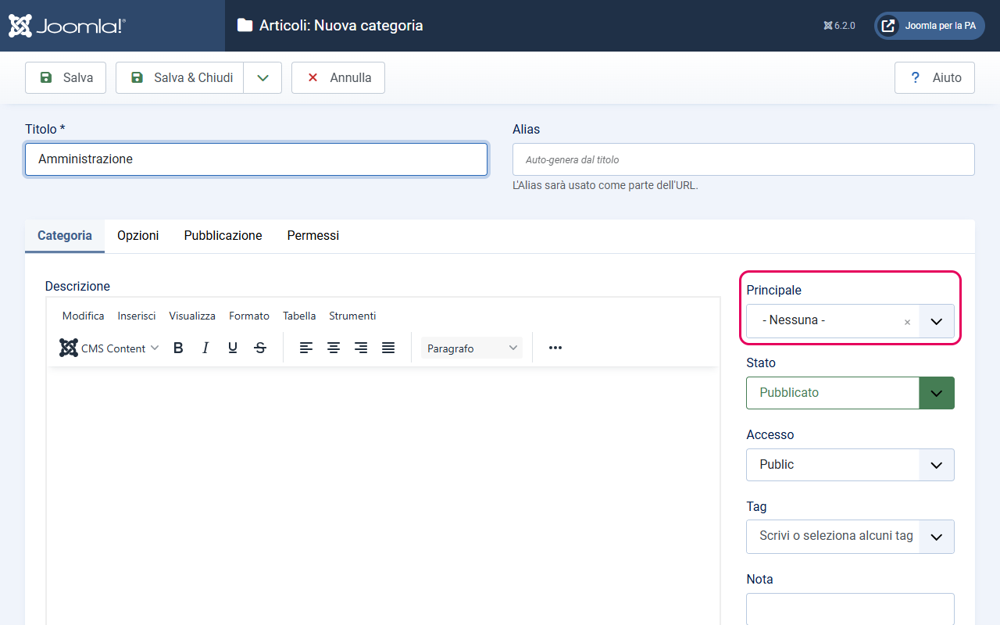
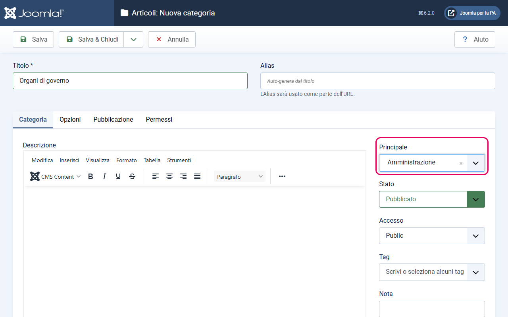

# Alberatura delle categorie

> **Modello Comuni** — Questa guida è specifica per i siti web dei Comuni italiani.

Joomla organizza i contenuti in categorie disposte ad albero (una categoria può contenere sottocategorie, che possono contenere ulteriori sottocategorie, e così via). Il template include layout grafici specializzati per quattro categorie principali: **Amministrazione**, **Novità**, **Servizi** e **Vivere il Comune**. Affinché questi layout funzionino correttamente, è necessario creare le categorie con una struttura precisa.

---

## Perché la struttura delle categorie è importante

Ogni layout specializzato del template (Servizi, Notizie, Amministrazione, Vivere il Comune) viene assegnato alla voce di menu che punta a una specifica categoria. Se la categoria non esiste, la voce di menu non può essere creata e il layout non può essere usato.

Inoltre, alcune funzionalità dipendono dalla gerarchia delle categorie: per esempio, la sidebar "Servizi in evidenza" nella pagina Servizi mostra automaticamente i servizi marcati come "In evidenza" della categoria corrente **e di tutte le sue sottocategorie**.

---

## Struttura consigliata per un Comune

Di seguito trovi la struttura completa delle categorie richiesta dal Modello Comuni. I nomi esatti che vedi qui sono quelli da usare — cambiarli non crea problemi tecnici, ma potrebbe rendere difficile riconoscere le categorie durante la configurazione.

```
Amministrazione
├── Organi di governo
├── Aree amministrative
├── Uffici
├── Enti e Fondazioni
├── Politici
├── Personale Amministrativo
├── Documenti e Dati
└── ...

Novità
├── Notizie
├── Comunicati
└── Avvisi

Servizi
├── Agricoltura e Pesca
├── Ambiente
├── Anagrafe e stato civile
├── Educazione e formazione
├── Tributi, finanze e contravvenzioni
├── Appalti pubblici
├── Autorizzazioni
├── Catasto e urbanistica
├── Cultura e tempo libero
├── Giustizia e sicurezza pubblica
├── Imprese e commercio
├── Mobilità e trasporti
├── Salute, benessere e assistenza
├── Turismo
├── Vita lavorativa
└── ...

Vivere il Comune
├── Eventi
└── Luoghi
```

Questa struttura rispecchia l'alberatura ufficiale del Modello Comuni (Designers Italia).

---

## Come creare le categorie in Joomla

Ogni categoria va creata manualmente nel backend. Il processo è lo stesso per tutte le categorie, sia quelle di primo livello che le sottocategorie.

### Creare una categoria di primo livello

1. Dal menu del backend, vai su **Contenuto → Categorie → Nuova**
2. Nel campo **Titolo**, inserisci il nome della categoria (es. `Amministrazione`)
3. Nel campo **Alias**, Joomla lo compila automaticamente in minuscolo con trattini. Puoi lasciarlo così oppure personalizzarlo (es. `amministrazione`)
4. Nel campo **Principale** (colonna destra), lascia selezionato `- Nessuna -` — questa è una categoria radice
5. Nel campo **Stato**, seleziona `Pubblicato`
6. Clicca **Salva e chiudi**

Ripeti questi passi per creare: **Amministrazione**, **Novità**, **Servizi**, **Vivere il Comune**.



### Creare una sottocategoria

Il processo è identico, con una sola differenza: il campo **Principale** deve puntare alla categoria madre.

Esempio: per creare la sottocategoria "Organi di governo" dentro "Amministrazione":

1. Dal menu del backend, vai su **Contenuto → Categorie → Nuova**
2. Nel campo **Titolo**, inserisci `Organi di governo`
3. Nel campo **Principale**, seleziona `Amministrazione` dal menu a tendina
4. Lascia lo stato su `Pubblicato`
5. Clicca **Salva e chiudi**

Ripeti questo processo per ogni sottocategoria, selezionando ogni volta la categoria madre corretta.



---

## Alias consigliati

L'alias è la parte dell'URL che identifica la categoria. Joomla lo genera automaticamente dal titolo, ma puoi personalizzarlo. Questi sono gli alias consigliati per le categorie principali, necessari per garantire URL leggibili e coerenti:

| Categoria | Alias consigliato |
|-----------|-------------------|
| Amministrazione | `amministrazione` |
| Novità | `novita` |
| Servizi | `servizi` |
| Vivere il Comune | `vivere-il-comune` |
| Notizie (sotto Novità) | `notizie` |
| Comunicati (sotto Novità) | `comunicati` |
| Avvisi (sotto Novità) | `avvisi` |
| Eventi (sotto Vivere il Comune) | `eventi` |
| Luoghi (sotto Vivere il Comune) | `luoghi` |

Per le sottocategorie di Servizi e Amministrazione, l'alias generato automaticamente va bene.

---

## Quale layout assegnare a ogni categoria

Una volta create le categorie, devi creare le **voci di menu** che le collegano ai layout del template. Ogni categoria principale usa un layout diverso:

| Categoria | Tipo di voce di menu da scegliere |
|-----------|----------------------------------|
| Amministrazione | Articoli → Amministrazione (Modello PA) |
| Novità o Notizie | Articoli → Notizie (Modello PA) |
| Servizi | Articoli → Servizi (Modello PA) |
| Vivere il Comune | Articoli → Vivere il Comune (Modello PA), oppure DPCalendar → Vivere il Comune - DPCalendar (Modello PA) se usi DPCalendar |

I layout del template compaiono nell'elenco dei tipi di voce di menu, accanto a "Blog categoria" e "Lista categoria": non c'è un campo "Layout" da impostare a parte.

Le istruzioni dettagliate per ogni layout si trovano nelle guide dedicate:
- [Layout Amministrazione](layout-amministrazione.md)
- [Layout Notizie](layout-notizie.md)
- [Layout Servizi](layout-servizi.md)
- [Layout Vivere il Comune](layout-vivere.md)

---

## Note aggiuntive

- Il template non impone vincoli sul numero di livelli di profondità: puoi aggiungere sottocategorie alle sottocategorie quanto vuoi.
- Le sottocategorie di Servizi (es. "Ambiente", "Tributi") vengono mostrate automaticamente nella sezione "Esplora per categoria" del layout Servizi.
- Le sottocategorie di Amministrazione compaiono nella sezione "Esplora l'amministrazione" del layout Amministrazione con `data-element="management-category-link"`.
- Per aggiungere nuove sottocategorie ai Servizi in futuro, crea semplicemente una nuova categoria con "Servizi" come genitore: comparirà automaticamente nella pagina.
