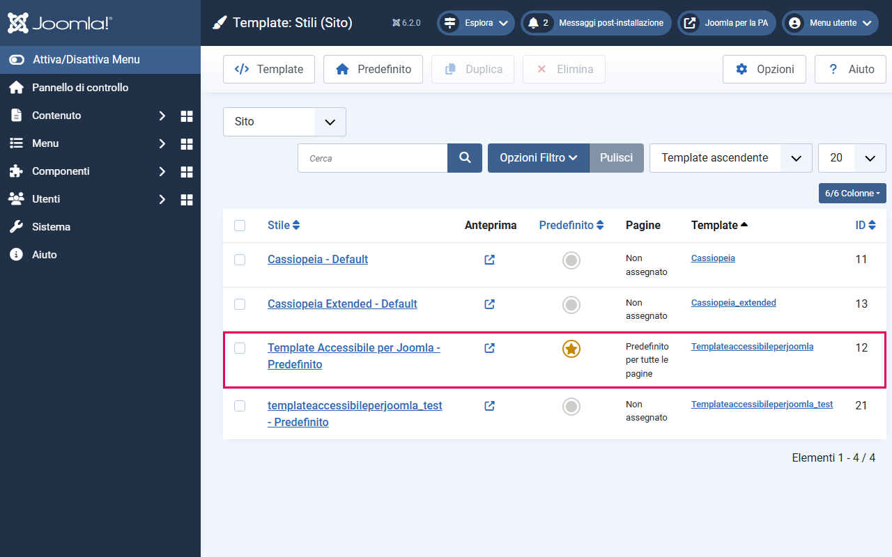
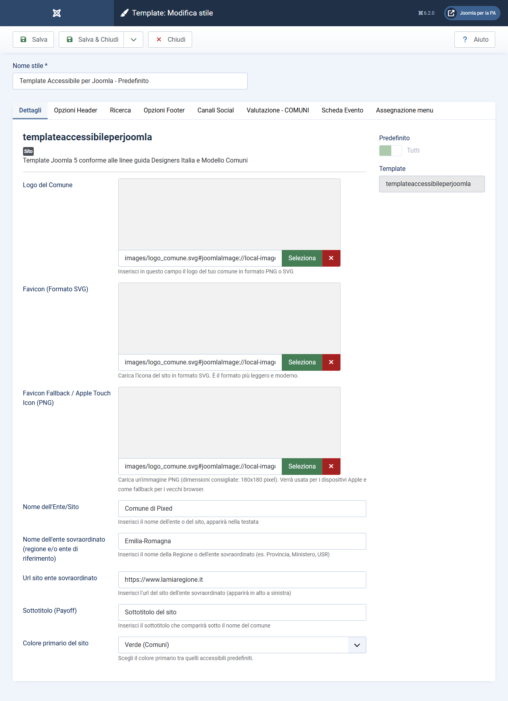
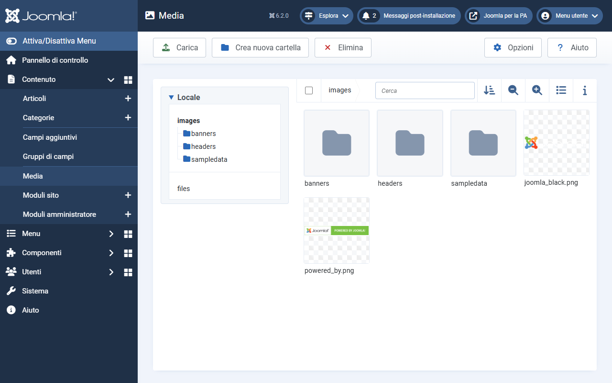
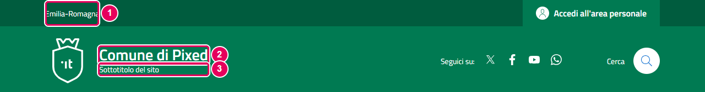
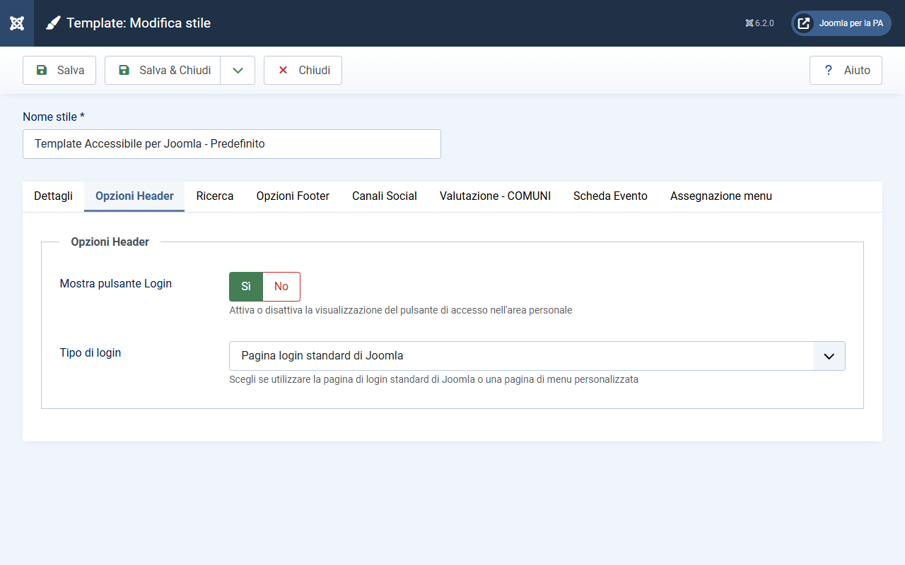
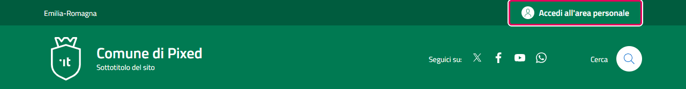
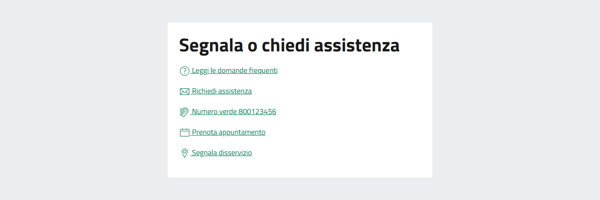
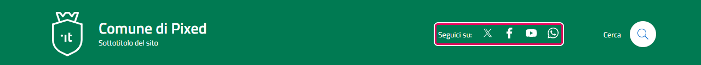

# Configurazione del template

Questa guida spiega come accedere alle impostazioni del template e cosa fa ogni parametro.

---

## Come accedere alle impostazioni

1. Dal backend di Joomla, vai su **Sistema → Stili template sito**
2. Nella lista, trova la riga del **Template Accessibile per Joomla** e clicca sul suo nome (non sull'icona della stellina, ma sul nome testuale)
3. Si aprirà il pannello di configurazione con tutte le schede (tab) disponibili

Le impostazioni sono organizzate nelle schede seguenti:

- **Dettagli** — branding e colore primario
- **Opzioni Header** — pulsante di accesso all'area personale
- **Ricerca** — icona, riquadro di ricerca e filtri della pagina dei risultati
- **Opzioni Footer** — logo UE, pulsante «Torna in cima» e blocco «Contatta l'ente»
- **Canali Social** — link ai canali social
- **Valutazione - COMUNI** — mapping data-element, widget feedback e campi della Scheda Servizio *(solo Modello Comuni)*
- **Scheda Evento** — campi della scheda evento di DPCalendar *(solo con DPCalendar)*

---

## Scheda: Dettagli

Questa scheda contiene le impostazioni di identità visiva del sito. È la prima da compilare quando si configura un nuovo sito.

### Sezione: Logo

| Campo | Tipo | Descrizione |
|-------|------|-------------|
| Logo del Comune | Media | L'immagine del logo visualizzata nell'header. |
| Favicon (Formato SVG) | Media | L'icona mostrata nella scheda del browser, in formato SVG. |
| Favicon Fallback / Apple Touch Icon (PNG) | Media | Fallback dell'icona per dispositivi Apple (180×180 pixel). |

**Come caricare il logo:**
1. Clicca sul campo **Logo del Comune** — si aprirà il Media Manager di Joomla
2. Seleziona l'immagine già caricata, oppure usa il pulsante **Carica** per caricarla
3. Clicca **Inserisci media** per confermare
4. Ripeti per i due campi Favicon, se hai i file

**Formato consigliato per il logo:** SVG. Un file SVG è vettoriale — rimane nitido a qualsiasi dimensione e su qualsiasi schermo, anche ad alta densità di pixel (Retina). Se non hai un SVG, usa un PNG trasparente ad alta risoluzione.

**Favicon:** il browser moderno usa il formato SVG (scalabile); se hai anche il PNG, Joomla lo imposta automaticamente come `apple-touch-icon` per iOS. Puoi caricare solo il PNG se non hai l'SVG — funziona comunque.

### Sezione: Identità

| Campo | Tipo | Descrizione |
|-------|------|-------------|
| Nome dell'Ente/Sito | Testo | Il nome dell'ente (es. `Comune di Milano`). Appare nell'header e nei metadati JSON-LD delle schede servizio. |
| Nome dell'ente sovraordinato | Testo | Il nome della regione o ente sovraordinato (es. `Regione Lombardia`). Appare nella banda slim superiore. |
| Url sito ente sovraordinato | URL | Il link al sito della regione. Se compilato, il nome della regione diventa cliccabile. |
| Sottotitolo (Payoff) | Testo | Il sottotitolo sotto il nome del comune (es. `Città Metropolitana`). |

**Importante:** il campo **Nome dell'Ente/Sito** viene usato anche come `areaServed` nel blocco JSON-LD delle Schede Servizio. Compila sempre questo campo con il nome ufficiale e completo dell'ente.

*1 — Nome della Regione · 2 — Nome del Comune · 3 — Sottotitolo (payoff)*

### Sezione: Colore primario

| Campo | Tipo | Descrizione |
|-------|------|-------------|
| Colore primario del sito | Lista | Seleziona la palette colore tra le 5 disponibili. |

Vedi la guida dedicata: [colori-e-temi.md](colori-e-temi.md).

---

## Scheda: Opzioni Header

Questa scheda controlla il pulsante di accesso all'area personale, mostrato nella topbar. I campi della ricerca sono nella scheda **Ricerca**.

### Sezione: Login

| Campo | Tipo | Appare quando | Descrizione |
|-------|------|---------------|-------------|
| Mostra pulsante Login | Radio (Sì/No) | sempre | Abilita o disabilita il pulsante "Accedi all'area personale". Default: No. |
| Tipo di login | Lista | solo se Sì | **Pagina login standard di Joomla** (`standard`) = apre il form login nativo di Joomla; **Seleziona pagina di menu** (`menuitem`) = rimanda a una pagina personalizzata. |
| Seleziona menu per login | Voce di menu | solo con "Seleziona pagina di menu" | La voce di menu della pagina di login. |

**Come funziona:**
- Se scegli **Pagina login standard di Joomla**, il pulsante aprirà direttamente il form di login di Joomla (componente `com_users`). Non richiede altre configurazioni.
- Se scegli **Seleziona pagina di menu**, devi avere già creato una voce di menu che porta alla tua pagina di login (es. una pagina con un modulo di login personalizzato) e selezionarla nel campo **Seleziona menu per login**.

---

## Scheda: Ricerca

Dalla 1.3.0 la ricerca ha una scheda propria. I tre campi che prima stavano in **Opzioni Header** (`mostra_ricerca`, `tipo_ricerca`, `menuitem_ricerca`) sono stati spostati qui senza cambiare nome: i valori già salvati restano validi.

La ricerca usa il **Motore di ricerca** di Joomla (*Smart Search*, `com_finder`): il template ne ridisegna la pagina dei risultati e aggiunge un riquadro di ricerca a tutta pagina. Cosa viene trovato e quali voci compaiono nei filtri dipende dall'indice di Joomla, non dal template.

> La guida completa, con i prerequisiti di Joomla, il funzionamento dei filtri, la manutenzione dell'indice e la risoluzione dei problemi, è in **[Ricerca nel sito](ricerca.md)**. Qui sotto c'è solo l'elenco dei campi.

| Campo | Parametro | Predefinito | Descrizione |
|-------|-----------|-------------|-------------|
| Mostra pulsante Ricerca | `mostra_ricerca` | No | Mostra l'icona di ricerca nella testata. |
| Al clic sull'icona | `ricerca_apertura` | Apri la pagina | `pagina` = apre la pagina di ricerca; `modale` = apre il riquadro a tutta pagina con campo, pulsante "Cerca" e link "Ricerca avanzata". |
| Pagina di ricerca | `tipo_ricerca` | Smart Search standard | `smartsearch` = pagina dei risultati del Motore di ricerca; `menuitem` = una voce di menu. |
| Seleziona menu per ricerca | `menuitem_ricerca` | — | La voce di menu della pagina di ricerca. Appare solo con `menuitem`. |
| Suggerimenti durante la digitazione | `ricerca_suggerimenti` | No | Propone i termini mentre si scrive. Richiede anche l'opzione "Suggerimenti di ricerca" del Motore di ricerca. |
| Mostra i filtri | `ricerca_filtri` | Sì | Colonna dei filtri a sinistra dei risultati. |
| Filtro per tipologia | `ricerca_filtri_tipo` | Sì | Gruppo "Tipologie" (articoli, categorie, tag…). |
| Filtro per categoria | `ricerca_filtri_cat` | Sì | Gruppo "Categorie". |
| Categorie da mostrare | `ricerca_filtri_categorie` | vuoto (tutte) | Selezione multipla. Scegliendo una categoria compaiono anche le sue sottocategorie. |
| Selezione inversa | `ricerca_filtri_categorie_inverti` | No | Le categorie scelte vengono nascoste e si mostrano tutte le altre. |

---

## Scheda: Opzioni Footer

La scheda ha due parti: le opzioni del footer e, sotto la nota «Contatta l'ente», i campi del blocco di contatto.

| Campo | Tipo | Appare quando | Descrizione |
|-------|------|---------------|-------------|
| Mostra logo Unione Europea | Radio (Sì/No) | sempre | Mostra il logo dell'Unione Europea nel footer. Default: Sì. |
| Attivare «Torna in cima»? | Radio (Sì/No) | sempre | Mostra un pulsante per tornare all'inizio della pagina. Default: No. |
| Tipo di pulsante | Lista | solo se Sì | **Flottante** = pulsante fisso nell'angolo della finestra (default); **Statico in fondo al footer** = link centrato in fondo al footer. |
| Posizione del pulsante flottante | Lista | solo con "Flottante" | **In basso a destra** (default) oppure **In basso a sinistra**. |

Il logo UE viene mostrato nella prima riga del footer, a sinistra del logo del Comune. Impostalo su **No** solo se il tuo ente non è co-finanziato da fondi UE.

### Blocco «Contatta l'ente»

Questi campi configurano il blocco **"Contatta il Comune"** che appare tra il contenuto principale e il footer (sul sito ha il titolo "Segnala o chiedi assistenza"). Il blocco si attiva automaticamente quando almeno uno dei campi qui sotto è compilato — se tutti sono vuoti, il blocco non viene mostrato.

| Campo | Tipo | Descrizione |
|-------|------|-------------|
| Voce menu: Domande frequenti | Voce di menu | Crea il link "Leggi le domande frequenti" |
| Voce menu: Richiedi assistenza | Voce di menu | Crea il link "Richiedi assistenza" con `data-element="contacts"` |
| Numero verde | Testo | Il numero di telefono dell'ente (es. `800 123 456`). Viene trasformato in un link cliccabile `tel:`. |
| Voce menu: Prenota appuntamento | Voce di menu | Crea il link "Prenota appuntamento" con `data-element="appointment-booking"` |
| Voce menu: Segnala disservizio | Voce di menu | Crea il link "Segnala disservizio" |

**Come configurare:**
1. Prima crea le pagine necessarie come articoli Joomla (es. una pagina FAQ, una pagina Contatti) e le relative voci di menu
2. Torna su **Sistema → Stili template sito**, apri il template e vai alla scheda **Opzioni Footer**
3. Per ogni campo, scegli la voce di menu corrispondente dall'elenco a tendina
4. Per il telefono, digita solo il numero (puoi includere spazi per leggibilità: `800 123 456`)
5. Salva

**Nota:** I campi `data-element="contacts"` e `data-element="appointment-booking"` sono richiesti dall'App Valutazione Modelli per i siti Comuni. Vedi [valutazione-modelli.md](valutazione-modelli.md).

---

## Scheda: Canali Social

Ogni campo accetta un URL completo. Se un campo è lasciato vuoto, l'icona social corrispondente non viene mostrata — né nell'header né nel footer.

| Campo | Tipo | Esempio |
|-------|------|---------|
| X (Twitter) | URL | `https://x.com/comune_milano` |
| Facebook | URL | `https://www.facebook.com/comunemilano` |
| YouTube | URL | `https://www.youtube.com/channel/...` |
| Telegram | URL | `https://t.me/comunemilano` |
| WhatsApp | Testo | Solo il numero, es. `+39 02 12345678` |
| LinkedIn | URL | `https://www.linkedin.com/company/...` |

**Nota sul campo WhatsApp:** inserisci solo il numero di telefono (con prefisso internazionale, es. `+39 02 12345678`). Il template genera automaticamente il link `https://wa.me/390212345678` rimuovendo simboli e spazi. Non inserire un URL: inserisci solo il numero.

I social configurati qui appaiono in due posti: nell'header (a destra, prima della ricerca) e nel footer (sezione "Seguici su:"). Non esiste una configurazione separata per header e footer — stesso set di valori.

---

## Scheda: Valutazione - COMUNI

> **Solo Modello Comuni** — Questa scheda è necessaria solo per i siti web dei Comuni italiani.

Questa scheda serve a collegare le voci di menu del tuo sito ai `data-element` richiesti dall'App Valutazione Modelli, e ad abilitare il widget di feedback. Per la guida completa, vedi [valutazione-modelli.md](valutazione-modelli.md).

---

## Scheda: Scheda Evento

> **Solo con DPCalendar** — Questa scheda serve solo se il sito usa il componente DPCalendar per gli eventi.

Associa i campi personalizzati degli eventi alle sezioni della pagina del singolo evento. Per la guida completa, vedi [scheda-evento.md](scheda-evento.md).
