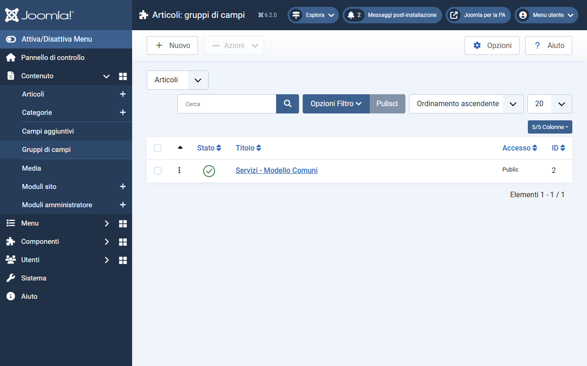
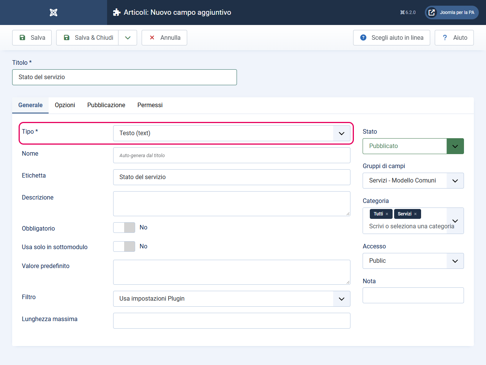
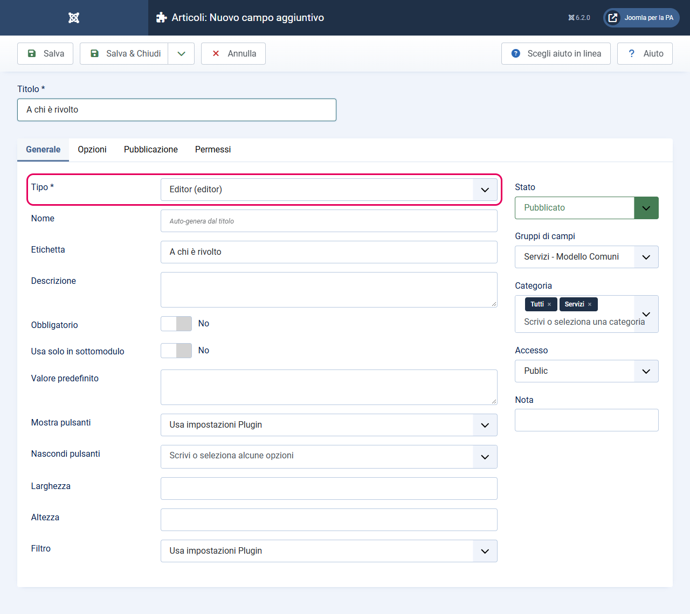
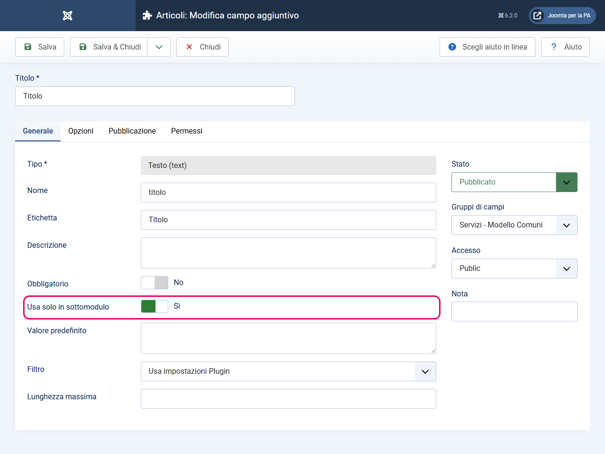
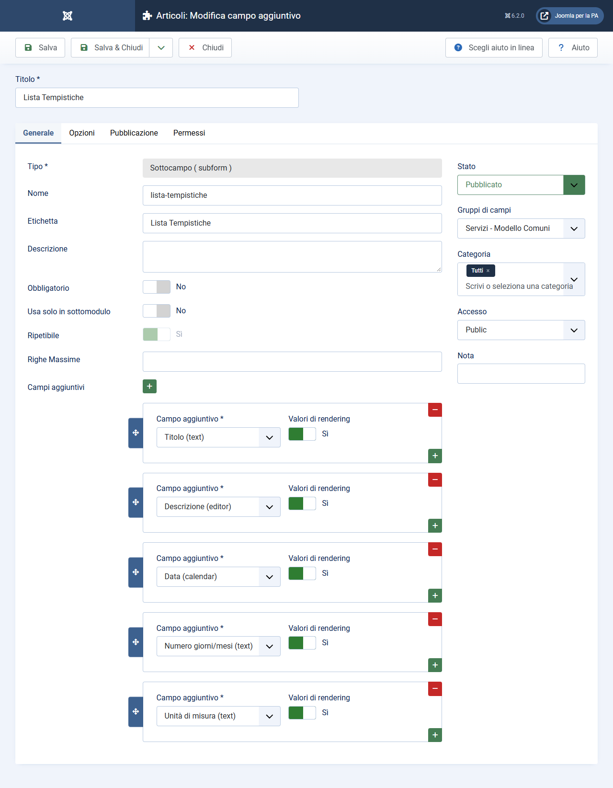
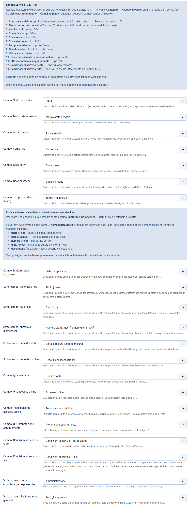
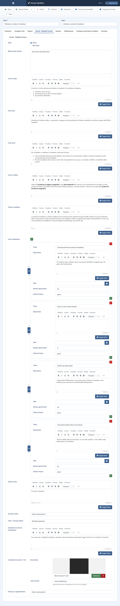

# Custom field per gli articoli

> **Modello Comuni** — Questa guida è specifica per i siti web dei Comuni italiani.

I custom field (campi personalizzati) di Joomla servono ad aggiungere informazioni strutturate agli articoli, al di là del semplice testo dell'editor. Nel contesto del Modello Comuni, vengono usati per compilare le sezioni della **Scheda Servizio**: ogni sezione (es. "A chi è rivolto", "Come fare", "Quanto costa") corrisponde a un campo personalizzato.

---

## Come funziona il sistema

Il layout `scheda-servizio` del template non legge i contenuti direttamente dai campi per nome: usa un sistema di **mapping**. In pratica:

1. **Crei i campi personalizzati** in Joomla (con i nomi che preferisci)
2. **Mappi i campi** nella scheda "Valutazione - COMUNI" delle impostazioni del template: per ogni sezione della Scheda Servizio, selezioni il campo corrispondente
3. **Compili i campi** negli articoli a cui assegni il layout `scheda-servizio`

Questo sistema ti permette di rinominare i campi come vuoi, e di riutilizzare gli stessi campi in più layout senza vincoli.

---

> **Scorciatoia:** il plugin [Dati di esempio](dati-di-esempio.md) crea tutti i campi di questa pagina e li associa nei parametri del template. Questa guida resta utile per capire cosa viene creato o per farlo a mano.

## Prima di iniziare: crea un Gruppo di Campi

Joomla permette di raggruppare i campi personalizzati in "Gruppi di Campi" (visibili come schede nell'editor articolo). Prima di creare i singoli campi, crea un gruppo dedicato per tenerli organizzati.

1. Vai su **Contenuto → Gruppi di campi**: nel selettore in alto deve essere scelto **Articoli** (il gruppo vale per gli articoli)
2. Clicca **Nuovo** e nel campo **Titolo** inserisci `Servizi - Modello Comuni`
3. Salva

D'ora in poi, quando crei i campi singoli, puoi assegnarli a questo gruppo. Nell'editor articolo appariranno raggruppati in una scheda dedicata.

---

## Elenco completo dei campi da creare

Di seguito trovi tutti i campi necessari per la Scheda Servizio, con il tipo Joomla da usare per ciascuno.

| Nome campo | Tipo Joomla | Categoria campo | Note |
|------------|-------------|-----------------|------|
| Stato | Radio button | Servizi | Due opzioni: "Servizio attivo" con valore `1`, "Servizio non attivo" con valore `0` |
| Motivo stato servizio | Area di testo | Servizi | Mostrato solo quando lo Stato è "non attivo" |
| A chi è rivolto | Editor | Servizi | Testo HTML |
| Come fare | Editor | Servizi | Testo HTML |
| Cosa serve | Editor | Servizi | Testo HTML |
| Cosa si ottiene | Editor | Servizi | Testo HTML |
| Tempi e scadenze | Editor | Servizi | Testo introduttivo della sezione |
| Lista Tempistiche | Sottocampo (subform) | **Tutti** | Vedi istruzioni speciali sotto |
| Quanto costa | Editor | Servizi | Testo HTML |
| Accesso online | URL | Servizi | Link al portale online |
| Testo - Accesso Online | Testo | Servizi | Etichetta del pulsante |
| Condizioni di servizio - Introduzione | Editor | Servizi | Testo HTML delle condizioni |
| Condizioni di servizio - FILE | Documento (Joomla 6.1+) oppure URL | Servizi | PDF delle condizioni, vedi la sezione dedicata sotto |
| Prenota un appuntamento | URL | Servizi | Link alla prenotazione |

I campi dentro la subform (Titolo, Data, ecc.) sono spiegati in una sezione separata.

---

## Come creare un campo di tipo Testo

Usato per: **Testo - Accesso Online**

> Il campo **Stato** non è di tipo Testo ma **Radio button**: creane uno con due opzioni, *Servizio attivo* (valore `1`) e *Servizio non attivo* (valore `0`). Il template considera il servizio non attivo solo quando il valore salvato è `0`: in quel caso il badge diventa rosso e viene mostrato il campo **Motivo stato servizio** (tipo Area di testo).

1. Vai su **Contenuto → Campi aggiuntivi → Nuovo**
2. Nel campo **Titolo**, inserisci il nome del campo (es. `Testo - Accesso Online`)
3. Nel campo **Tipo**, seleziona **Testo**
4. Nel campo **Gruppo**, seleziona **Servizi - Modello Comuni**
5. Nel campo **Categoria**, seleziona la categoria **Servizi** (così il campo appare solo sugli articoli di quella categoria)
6. Lascia le altre impostazioni ai valori predefiniti
7. Clicca **Salva e chiudi**

---

## Come creare un campo di tipo Editor

Usato per: **A chi è rivolto**, **Come fare**, **Cosa serve**, **Cosa si ottiene**, **Tempi e scadenze**, **Quanto costa**, **Condizioni di servizio - Introduzione**

1. Vai su **Contenuto → Campi aggiuntivi → Nuovo**
2. Nel campo **Titolo**, inserisci il nome del campo (es. `A chi è rivolto`)
3. Nel campo **Tipo**, seleziona **Editor**
4. Nel campo **Gruppo**, seleziona **Servizi - Modello Comuni**
5. Nel campo **Categoria**, seleziona **Servizi**
6. Clicca **Salva e chiudi**

Ripeti il processo per tutti gli altri campi di tipo Editor.

**Perché Editor e non Textarea?** Il tipo Editor apre l'editor visuale di Joomla (TinyMCE o simile), che permette di formattare il testo, inserire elenchi puntati, grassetti, corsivi, ecc. Per le sezioni della Scheda Servizio, questo è spesso necessario per strutturare le informazioni in modo chiaro.

---

## Come creare un campo di tipo URL

Usato per: **Accesso online**, **Prenota un appuntamento** e, su Joomla 5.x / 6.0, **Condizioni di servizio - FILE**

1. Vai su **Contenuto → Campi aggiuntivi → Nuovo**
2. Nel campo **Titolo**, inserisci il nome del campo (es. `Accesso online`)
3. Nel campo **Tipo**, seleziona **URL**
4. Nel campo **Gruppo**, seleziona **Servizi - Modello Comuni**
5. Nel campo **Categoria**, seleziona **Servizi**
6. Clicca **Salva e chiudi**

---

## Il campo "Condizioni di servizio - FILE": Documento oppure URL

Il tipo di campo da usare dipende dalla versione di Joomla.

### Joomla 6.1 o superiore: campo di tipo Documento

Dalla 6.1 il plugin dei campi Media offre quattro tipi: Immagine (`media`), Audio (`media_audio`), Video (`media_video`) e **Documento (`media_document`)**. Il tipo Documento apre il Media Manager sulla cartella **Documenti** e permette di scegliere o caricare un PDF.

1. Vai su **Contenuto → Campi aggiuntivi → Nuovo**
2. Nel campo **Titolo**, inserisci `Condizioni di servizio - FILE`
3. Nel campo **Tipo**, seleziona **Documento (media_document)**
4. Nel campo **Gruppo**, seleziona **Servizi - Modello Comuni**
5. Nel campo **Categoria**, seleziona **Servizi**
6. Clicca **Salva e chiudi**

Nell'articolo, oltre al file, il campo offre un **Testo del link**: se lo compili, il template lo usa come testo del link nella sezione "Condizioni di servizio"; se lo lasci vuoto usa il testo predefinito del template. Il segnaposto `{filename}` viene sostituito con il nome del file, come fa Joomla.

### Joomla 5.x e 6.0: campo di tipo URL

In queste versioni il campo di tipo **Media** mostra nel Media Manager **solo immagini** (il campo sottostante usa il filtro predefinito `images`), quindi un PDF non è selezionabile. Usa un campo di tipo **URL** che punta al PDF caricato nel Media Manager:

1. Vai su **Contenuto → Media** e apri la cartella **Documenti** (`files`) oppure una sottocartella dedicata, ad esempio `files/condizioni-servizio`
2. Carica il PDF con **Carica**
3. Clicca sul file e copia il suo indirizzo (voce **Copia URL** nell'anteprima, oppure annota il percorso, ad esempio `files/condizioni-servizio/asilo-nido.pdf`)
4. Nell'articolo, incolla l'indirizzo nel campo **Condizioni di servizio - FILE**

In entrambi i casi il template accetta sia l'indirizzo completo (`https://www.comune.esempio.it/files/...`) sia il percorso relativo alla root del sito (`files/...`): nel secondo caso lo completa da solo. Nella sezione "Condizioni di servizio" della Scheda Servizio comparirà il link con `data-element="service-file"`.

> Se cambi tipo di campo (per esempio da URL a Documento dopo un aggiornamento a Joomla 6.1), ricorda di aggiornare il mapping nelle opzioni del template e di ricompilare il campo negli articoli: i valori salvati con un tipo non vengono convertiti nell'altro.

---

## Come creare il campo Subform (Lista Tempistiche)

Il campo Subform è il più complesso: è un campo che contiene altri campi al suo interno, formando una lista di righe. Ogni riga rappresenta una scadenza o un'informazione temporale. Il campo Subform stesso **deve avere Categoria impostata su "Tutti"** (non solo "Servizi") — in caso contrario i sotto-campi non vengono caricati correttamente.

### Passo A: crea i sotto-campi della subform

Prima di creare il campo Subform, devi creare i campi che compariranno all'interno di ogni riga. Questi campi sono speciali: nella scheda **Generale** devono avere la voce **Usa solo in sottomodulo** impostata su **Sì**.

Crea i seguenti campi (nell'ordine non importa, ma è utile crearli tutti prima del Subform):

**Sotto-campo 1: Titolo**
1. **Contenuto → Campi aggiuntivi → Nuovo** → Tipo: **Testo**
2. Titolo: `Titolo`, Gruppo: `Servizi - Modello Comuni`, Categoria: `Servizi`
3. Scheda **Generale** → **Usa solo in sottomodulo**: **Sì**
4. Salva e chiudi

**Sotto-campo 2: Data**
1. **Contenuto → Campi aggiuntivi → Nuovo** → Tipo: **Calendario**
2. Titolo: `Data`, Gruppo: `Servizi - Modello Comuni`, Categoria: `Servizi`
3. Scheda **Generale** → **Usa solo in sottomodulo**: **Sì**
4. Salva e chiudi

**Sotto-campo 3: Numero giorni/mesi**
1. **Contenuto → Campi aggiuntivi → Nuovo** → Tipo: **Testo**
2. Titolo: `Numero giorni/mesi`, Gruppo: `Servizi - Modello Comuni`, Categoria: `Servizi`
3. Scheda **Generale** → **Usa solo in sottomodulo**: **Sì**
4. Salva e chiudi

**Sotto-campo 4: Unità di misura**
1. **Contenuto → Campi aggiuntivi → Nuovo** → Tipo: **Testo**
2. Titolo: `Unità di misura`, Gruppo: `Servizi - Modello Comuni`, Categoria: `Servizi`
3. Scheda **Generale** → **Usa solo in sottomodulo**: **Sì**
4. Salva e chiudi

**Sotto-campo 5: Descrizione**
1. **Contenuto → Campi aggiuntivi → Nuovo** → Tipo: **Area di testo** (non Editor: la descrizione viene mostrata come testo semplice, e con un Editor comparirebbero i tag HTML)
2. Titolo: `Descrizione`, Gruppo: `Servizi - Modello Comuni`, Categoria: `Servizi`
3. Scheda **Generale** → **Usa solo in sottomodulo**: **Sì**
4. Salva e chiudi

### Passo B: crea il campo Subform

Ora crea il campo Subform che conterrà i sotto-campi appena creati:

1. Vai su **Contenuto → Campi aggiuntivi → Nuovo**
2. Nel campo **Titolo**, inserisci `Lista Tempistiche`
3. Nel campo **Tipo**, seleziona **Sottocampo (subform)**: è il nome che il tipo Subform ha nell'interfaccia in italiano
4. Nel campo **Gruppo**, seleziona **Servizi - Modello Comuni**
5. Nel campo **Categoria**, seleziona **Tutti** (importante: non "Servizi" — il campo Subform deve essere visibile in tutti i contesti per caricare correttamente i sotto-campi)

6. Sempre nella scheda **Generale** compare l'elenco dei sotto-campi: aggiungi una riga per ciascuno dei 5 sotto-campi creati nel Passo A:
   - Titolo
   - Data
   - Numero giorni/mesi
   - Unità di misura
   - Descrizione

7. Imposta **Ripetibile** su **Sì** — questo permette di aggiungere più righe nella lista
8. Clicca **Salva e chiudi**

**Come usarlo nell'articolo:** nell'editor di un articolo con layout Scheda Servizio, il campo "Lista Tempistiche" mostrerà un pulsante per aggiungere righe. Per ogni scadenza, clicca "Aggiungi riga" e compila Titolo, Data (o Numero giorni/mesi + Unità di misura) e Descrizione.

---

## Come mappare i campi nel template

Dopo aver creato tutti i campi, devi collegare ciascun campo alla sezione corrispondente della Scheda Servizio nelle impostazioni del template.

1. Vai su **Sistema → Stili template sito** e clicca sul nome del template
2. Clicca sulla scheda **Valutazione - COMUNI**
3. Scorri fino alla sezione **Scheda Servizio**
4. Per ogni riga della sezione, clicca sul menu a tendina e seleziona il campo corrispondente:
   - "Campo: Stato del servizio" → seleziona **Stato**
   - "Campo: A chi è rivolto" → seleziona **A chi è rivolto**
   - "Campo: Come fare" → seleziona **Come fare**
   - ... e così via per tutti i campi
5. Per i sotto-campi del Subform:
   - "Campo Subform: Lista scadenze" → seleziona **Lista Tempistiche**
   - "Sotto-campo: titolo della riga" → seleziona **Titolo**
   - "Sotto-campo: data fissa" → seleziona **Data**
   - "Sotto-campo: numero di giorni/mesi" → seleziona **Numero giorni/mesi**
   - "Sotto-campo: unità di durata" → seleziona **Unità di misura**
   - "Sotto-campo: testo descrittivo" → seleziona **Descrizione**
6. Clicca **Salva**

---

## Come appare il campo nell'editor articolo

Una volta creati e mappati i campi, quando apri un articolo in modifica troverai una nuova scheda nell'editor (con il nome del gruppo "Servizi - Modello Comuni"). Questa scheda contiene tutti i campi che hai creato, pronti per essere compilati.

---

## Note

- Solo la sezione **Quanto costa** scompare quando il campo è vuoto. Le altre sezioni della Scheda Servizio mostrano sempre il titolo: un campo lasciato vuoto produce una sezione senza contenuto.
- Il campo **Stato** viene visualizzato come badge nell'intestazione della scheda servizio: verde per "Servizio attivo" (valore `1`), rosso per "Servizio non attivo" (valore `0`).
- Il validatore del Modello Comuni richiede che le sezioni principali abbiano contenuto di almeno 3 caratteri. Un campo compilato con solo uno spazio non supererebbe la verifica.
- I campi creati qui appaiono solo negli articoli della categoria **Servizi** (o di tutte le categorie, per il Subform). Non compaiono negli articoli di altre categorie.
