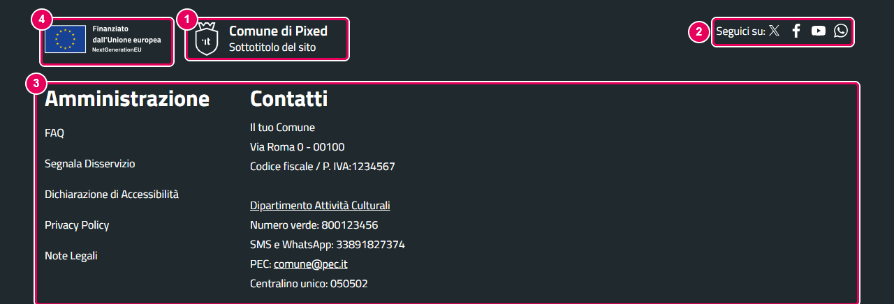
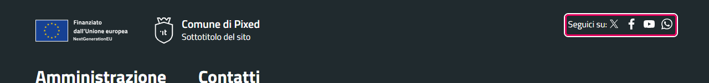
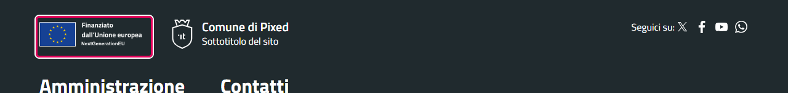
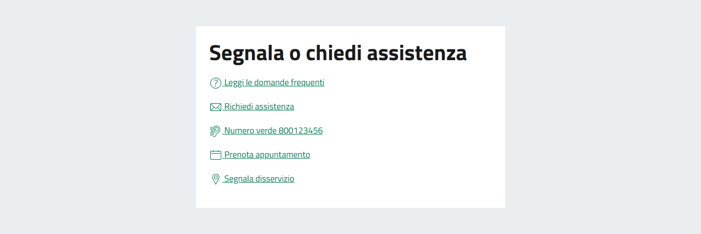

# Footer

Il footer è il piè di pagina del sito. È composto da più elementi: la riga con logo UE, logo del comune e social, e due posizioni modulo. Subito sopra il footer c'è il blocco "Contatta".

---

## Struttura del footer

Il footer è organizzato così, dall'alto verso il basso:

1. **Riga del logo**: logo dell'Unione Europea (se abilitato), logo del sito con nome del comune e payoff, "Seguici su:" con le icone social
2. **Posizione `footer1`**: una riga di moduli
3. **Posizione `footer2`**: una seconda riga di moduli, sotto la prima

Sopra il footer (ma tecnicamente separato da esso) c'è il blocco **"Contatta il Comune"**, configurato nella scheda **Opzioni Footer** del template (vedi [configurazione-joomla.md](configurazione-joomla.md#blocco-contatta-lente)).

*1 — Logo, nome del comune e payoff · 2 — "Seguici su" con le icone social · 3 — Posizione `footer1`, qui con due moduli affiancati (la posizione `footer2`, se contiene moduli, compare subito sotto) · 4 — Logo UE*

---

## Posizioni modulo del footer

Il footer ha due posizioni modulo, una sotto l'altra, dove puoi inserire qualsiasi modulo Joomla. I moduli pubblicati nella stessa posizione si dispongono affiancati, in colonne.

| Posizione | Descrizione |
|-----------|-------------|
| `footer1` | Prima riga di moduli del footer |
| `footer2` | Seconda riga di moduli, sotto `footer1` |

### Come aggiungere un modulo nel footer

1. Vai su **Contenuto → Moduli sito → Nuovo** e scegli il tipo di modulo
2. Nella scheda **Modulo** → campo **Posizione** (colonna destra), inserisci `footer1` oppure `footer2`
3. Imposta lo stato su **Pubblicato** e salva

### Cosa inserire nel footer

Tipicamente nel footer si inseriscono (usando moduli di tipo **Personalizzato** o **Menu**):

- Link istituzionali obbligatori: FAQ, Segnalazione disservizi, Dichiarazione di Accessibilità, Privacy Policy
- Link alla pagina Note Legali
- Informazioni di contatto dell'ente
- Menu secondari o link rapidi

**Nota per il Modello Comuni:** i link istituzionali (FAQ, Accessibilità, Privacy, Note legali, Segnalazione disservizio) non sono inseriti automaticamente dal template. Per farli riconoscere dall'App Valutazione Modelli:

1. crea un menu con le voci e mostralo con un modulo **Menu** nella posizione `footer1` o `footer2`;
2. nel modulo, scheda **Avanzate** → **Layout**, scegli **comuni-footer**: è il layout che aggiunge i `data-element` ai link (un modulo Personalizzato o un menu con il layout predefinito non li aggiungono);
3. associa le voci nella scheda **Valutazione - COMUNI** del template. Vedi [valutazione-modelli.md](valutazione-modelli.md).

Il plugin [Dati di esempio](dati-di-esempio.md) fa questi tre passi da solo.

---

## Social nel footer

I canali social configurati nella scheda **Canali Social** del template appaiono automaticamente **anche nel footer**, nella sezione "Seguici su:", con le stesse icone che appaiono nell'header.

Non esiste una configurazione separata per i social del footer: stessi URL, stesse icone. Se hai configurato i social nella scheda Canali Social, appaiono sia nell'header che nel footer senza azioni aggiuntive.

---

## Logo UE

Il template può mostrare il logo dell'Unione Europea nel footer.

**Come controllarlo:**
1. Vai su **Sistema → Stili template sito**, apri il template e vai alla scheda **Opzioni Footer**
2. Campo **Mostra logo Unione Europea**: seleziona **Sì** (default) o **No**
3. Salva

| Valore | Effetto |
|--------|---------|
| Sì (default) | Il logo UE appare nella prima riga del footer, a sinistra del logo del comune |
| No | Il logo UE non viene mostrato |

---

## Blocco "Contatta il Comune"

Il blocco "Contatta il Comune" è una sezione di link rapidi che appare **sopra il footer** (non dentro le colonne `footer1`/`footer2`). Mostra link a FAQ, Contatti, Telefono, Prenotazione appuntamento e Segnalazione disservizi.

Questo blocco si configura nella scheda **Opzioni Footer** delle impostazioni del template, sotto la nota «Contatta l'ente». Sul sito ha il titolo "Segnala o chiedi assistenza". Per la guida completa, vedi [configurazione-joomla.md](configurazione-joomla.md).

Il blocco appare **solo se almeno uno** dei campi del blocco è compilato. Se tutti i campi sono vuoti, il blocco non viene mostrato.

