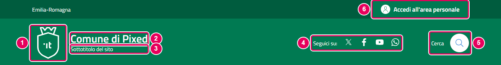
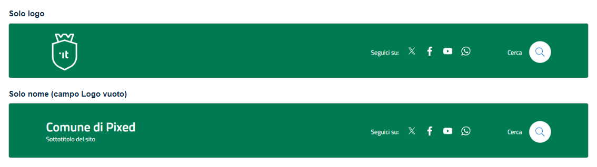
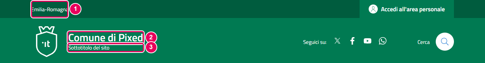
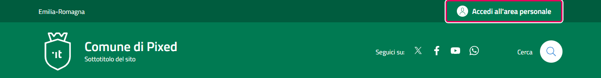
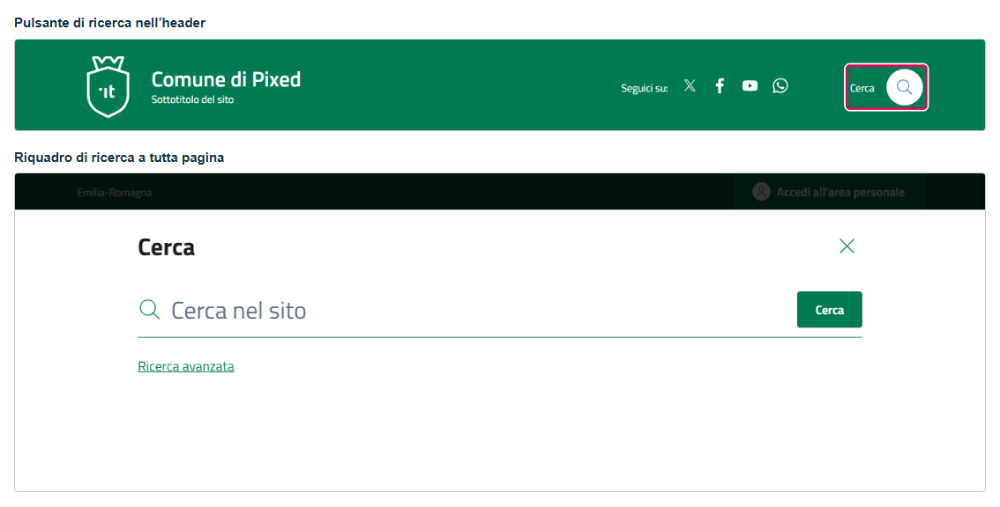
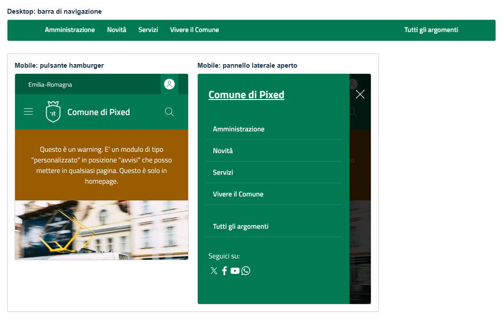

# Header

L'header è la testata del sito, visibile in cima a tutte le pagine. È composta da tre fasce sovrapposte, dall'alto verso il basso:

1. **Topbar** — banda slim con nome regione, cambio lingua e pulsante di accesso (vedere [topbar.md](topbar.md))
2. **Header center** — logo, nome ente, payoff, icone social e ricerca
3. **Navbar** — barra di navigazione con menu principale e menu secondario

---

## Header center

L'header center è la parte più visibile della testata. Contiene il logo, l'identità dell'ente e i controlli principali.



*1 — Logo · 2 — Nome del Comune · 3 — Payoff · 4 — Icone social · 5 — Ricerca · 6 — Accesso all'area personale (nella topbar)*

### Logo

Il logo appare a sinistra nell'header center.

- **Come configurarlo**: vai su **Sistema → Stili template sito **, apri il template e nella scheda **Dettagli** usa il campo **Logo del Comune** e carica l'immagine
- **Formato consigliato**: SVG (vettoriale, nitido su tutti gli schermi)
- **Se il campo è vuoto**: l'area logo non viene mostrata e il nome del comune si sposta a sinistra



### Nome comune, regione e payoff

Tre campi distinti contribuiscono all'identità testuale dell'ente nell'header:

| Parametro | Dove appare | Dove configurare |
|-----------|-------------|------------------|
| `nomesito` | Testo grande in grassetto, accanto al logo | Scheda Dettagli → **Nome dell'Ente/Sito** |
| `nomeregione` | Nella topbar, in alto a sinistra | Scheda Dettagli → **Nome dell'ente sovraordinato** |
| `payoff` | Testo piccolo sotto il nome | Scheda Dettagli → **Sottotitolo (Payoff)** |

**Esempio visivo:**
```
Regione Lombardia                  ← nomeregione (topbar, in alto a sinistra)

[LOGO]  Comune di Milano           ← nomesito (grande, in grassetto)
        Città Metropolitana        ← payoff (piccolo, sotto il nome)
```



*1 — Nome della Regione · 2 — Nome del Comune · 3 — Sottotitolo (payoff)*

### Icone social

Le icone dei canali social appaiono nell'header center a destra, prima della ricerca. Ogni icona viene mostrata solo se il relativo URL è configurato nella scheda **Canali Social** del template.

Social supportati: **X (Twitter)**, **Facebook**, **YouTube**, **Telegram**, **WhatsApp**, **LinkedIn**.

Per configurarli: vedi la sezione "Scheda: Canali Social" in [configurazione-joomla.md](configurazione-joomla.md).


### Bottone Login

Il bottone "Accedi all'area personale" si trova nella topbar, a destra, ed è visibile solo se **Mostra pulsante Login = Sì** nella scheda **Opzioni Header**.

**Due modalità:**
- **Standard**: apre direttamente il form di login nativo di Joomla (componente `com_users`). È la scelta più semplice — non richiede configurazioni aggiuntive.
- **Seleziona pagina di menu**: rimanda alla voce di menu selezionata in `menuitem_login`. Usa questa modalità se hai una pagina di login personalizzata (es. con SPID, CIE, o un modulo di login con grafica personalizzata).

Il bottone ha l'attributo `data-element="personal-area-login"`, richiesto dall'App Valutazione Modelli per i siti Comuni.



### Bottone Ricerca

Il bottone di ricerca è visibile solo se **Mostra pulsante Ricerca = Sì** nella scheda **Ricerca** dei parametri del template (fino alla 1.2.x questi campi stavano in **Opzioni Header**; i valori salvati restano validi).

**Al clic sull'icona** (`ricerca_apertura`):
- **Apri la pagina di ricerca** (predefinito): l'icona è un link alla pagina di ricerca.
- **Apri il riquadro di ricerca a tutta pagina**: si apre un modale con il campo di ricerca, il pulsante "Cerca" e il link "Ricerca avanzata" verso la pagina di ricerca. Si chiude con Esc o con il pulsante di chiusura; senza JavaScript l'icona resta un link alla pagina.

**Pagina di ricerca** (`tipo_ricerca`):
- **Smart Search standard**: la pagina dei risultati di Smart Search di Joomla.
- **Voce di menu**: la voce scelta in `menuitem_ricerca`. Se la voce non è di tipo Smart Search (per esempio un componente di ricerca diverso), l'icona è sempre un link: il modale non viene usato.

Il riquadro, la pagina dei risultati, i filtri e i prerequisiti di Joomla sono descritti nella guida [Ricerca nel sito](ricerca.md).



---

## Navbar (barra di navigazione)

La navbar è la barra orizzontale sotto l'header center. Contiene il menu principale e il menu secondario.

### Come funziona

La navbar riceve i moduli menu assegnati alle posizioni `menu-principale` e `menu-secondario`. È fondamentale che questi moduli usino il **layout alternativo `comuni-menu`**: senza di esso, l'HTML generato da Joomla non corrisponde alla struttura attesa da Bootstrap Italia e il menu non funzionerà visivamente.

Per la guida completa alla creazione dei menu: vedi [menu.md](menu.md).

### Comportamento su mobile

Su schermi piccoli (smartphone e tablet), la navbar si comprime in un pulsante hamburger (tre linee). Cliccandolo si apre un pannello laterale con entrambi i menu (principale e secondario).



---

## Accessibilità dell'header

Il template include automaticamente alcune funzionalità di accessibilità nell'header che non richiedono configurazione:

- **Skip links**: tre link nascosti visivamente (ma accessibili via tasto Tab) che permettono agli utenti di screen reader e tastiera di saltare direttamente al contenuto principale, al menu o al footer. Compaiono visivamente quando ricevono il focus.
- **Titolo H1 nascosto**: nell'header è presente un `<h1>` con il nome del sito, visivamente nascosto ma disponibile per gli screen reader. Questo garantisce che ogni pagina abbia un titolo di primo livello anche quando il contenuto principale usa `<h2>`.
- **Attributi `aria-label`**: tutte le aree di navigazione (topbar, header, navbar) hanno attributi `aria-label` che descrivono la loro funzione agli screen reader.
