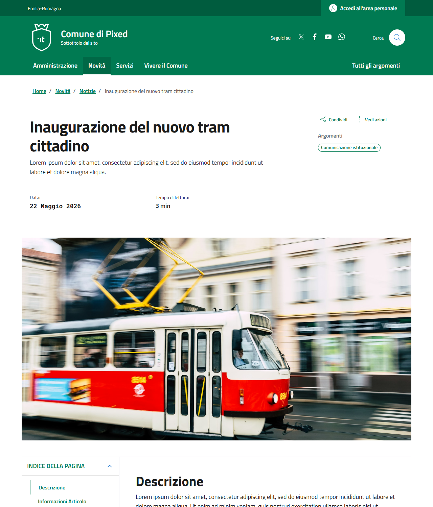
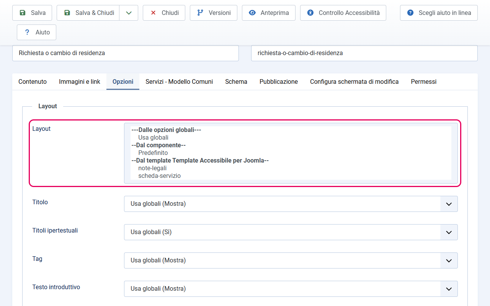
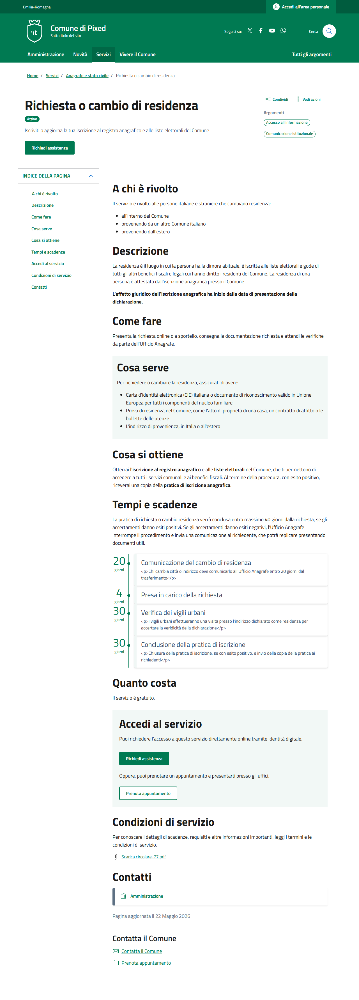
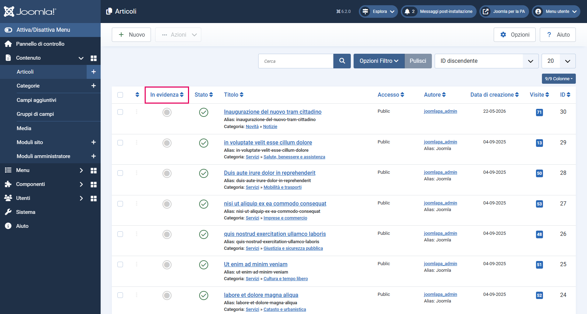

# Inserimento articoli

Gli articoli in Joomla si creano da **Contenuto → Articoli → Nuovo**. Il template fornisce layout grafici specializzati per alcuni tipi di contenuto, selezionabili articolo per articolo.

---

## Articolo standard

Per contenuti generici (pagine istituzionali, comunicati stampa, annunci, ecc.) non è necessario selezionare nessun layout alternativo. Quando non specifichi un layout, il template applica automaticamente il suo layout standard (`default.php`).

Il layout standard include automaticamente queste funzionalità:

- **Tempo di lettura stimato** — calcolato automaticamente in base alla lunghezza del testo (es. "Tempo di lettura: 3 min")
- **Indice di pagina con scrollspy** — un indice laterale con le voci fisse "Descrizione" e "Informazioni articolo" (la seconda solo se i dettagli dell'articolo sono mostrati), che evidenzia la sezione corrente durante lo scroll. Non viene costruito dai sottotitoli del testo. L'attributo `data-element="page-index"` viene emesso automaticamente.
- **Menu «Condividi»** — nell'intestazione dell'articolo, a destra: Facebook, X, LinkedIn, WhatsApp.
- **Menu «Vedi azioni»** — accanto a «Condividi»: Stampa e Invia (per email).
- **Widget feedback chiarezza** — appare in fondo a tutte le pagine di contenuto (articoli e liste di categoria) se abilitato nelle impostazioni del template (vedi [valutazione-modelli.md](valutazione-modelli.md)).
- **Paginazione** — se l'articolo fa parte di una categoria, possono comparire link all'articolo precedente e successivo.

---

## Come selezionare un layout alternativo

Se vuoi applicare uno dei layout specializzati del template (Scheda Servizio o Note Legali) a un articolo:

1. Vai su **Contenuto → Articoli** e apri l'articolo in modifica (oppure crea un nuovo articolo)
2. Nella scheda **Opzioni** (la trovi tra le schede sopra l'editor)
3. Trova il campo **Layout**
4. Clicca sul menu a tendina e seleziona il layout desiderato
5. Salva l'articolo

---

## Layout alternativi disponibili

### `scheda-servizio` — Scheda Servizio

Usato per gli articoli che descrivono i servizi del comune. Richiede la creazione e configurazione di campi personalizzati (custom fields).

**Quando usarlo:** per ogni articolo nella categoria Servizi che deve essere conforme al criterio C.SI.1.3 del Modello Comuni.

**Cosa genera:** una pagina strutturata con titolo, badge di stato, indice di pagina laterale, fino a 10 sezioni in ordine fisso con i contenuti del servizio, pulsanti di accesso, e blocco JSON-LD per i motori di ricerca.

Per la guida completa con tutti i passaggi: [scheda-servizio.md](scheda-servizio.md).

### `note-legali` — Pagina Note Legali

Usato per la pagina obbligatoria delle Note Legali (criterio C.SI.3.4 del Modello Comuni).

**Quando usarlo:** una sola volta, per la pagina Note Legali del sito.

**Cosa fa:** mostra il contenuto dell'articolo (che puoi usare per aggiungere note specifiche del tuo ente), e aggiunge automaticamente in fondo una sezione "Licenza dei contenuti" con il testo completo della licenza Creative Commons BY 4.0 in italiano. Questo testo non può essere modificato dall'editor — è fisso nel template per garantire che il testo ufficiale non venga alterato.

Per la guida completa: [note-legali.md](note-legali.md).

---

## Categorie e layout: due concetti distinti

È importante capire la differenza tra:

- **Layout dell'articolo** (`scheda-servizio`, `note-legali`): si imposta sull'**articolo singolo**, nella scheda Opzioni dell'articolo. Determina come viene visualizzato quell'articolo quando si apre la sua pagina.
- **Layout della categoria** (`servizi`, `notizie`, `amministrazione`, `vivere`): si imposta sulla **voce di menu** che punta alla categoria, scegliendolo come tipo di voce (es. "Servizi (Modello PA)"). Determina come viene visualizzata la lista degli articoli di quella categoria.

Questi due concetti sono completamente indipendenti. Puoi avere una categoria Servizi con layout `servizi` (che mostra la lista), e ogni singolo articolo in quella categoria con layout `scheda-servizio` (che mostra il dettaglio).

---

## Articoli in evidenza

Alcuni layout del template mostrano una sezione con articoli "in evidenza" (es. il carosello nella posizione `evidenza`, la sidebar dei Servizi, le notizie in primo piano). Per marcare un articolo come "in evidenza":

**Metodo 1 — Dalla lista articoli:**
1. Vai su **Contenuto → Articoli**
2. Nella colonna **In Evidenza**, clicca la stella dell'articolo che vuoi mettere in evidenza
3. La stella diventa colorata: l'articolo è ora "in evidenza"

**Metodo 2 — Dall'editor dell'articolo:**
1. Apri l'articolo in modifica
2. Nella scheda **Contenuto**, colonna destra → **In evidenza**: **Sì**
3. Salva

**Dove vengono usati gli articoli in evidenza:**
- Nel layout `servizi` → appaiono nella sidebar destra "Servizi in evidenza"
- Nel layout `notizie` → appaiono nella sezione "In evidenza" in cima alla pagina (solo pagina 1)
- Nel layout `amministrazione` → appaiono nella sezione "In evidenza" in cima alla pagina (solo pagina 1)
- Nel layout `vivere` → appaiono nelle sezioni "Eventi in evidenza" e "Luoghi in evidenza"
- Nel modulo `evidenza-singolo` → il carosello mostra solo gli articoli selezionati nel modulo (non usa il flag in evidenza della categoria)
