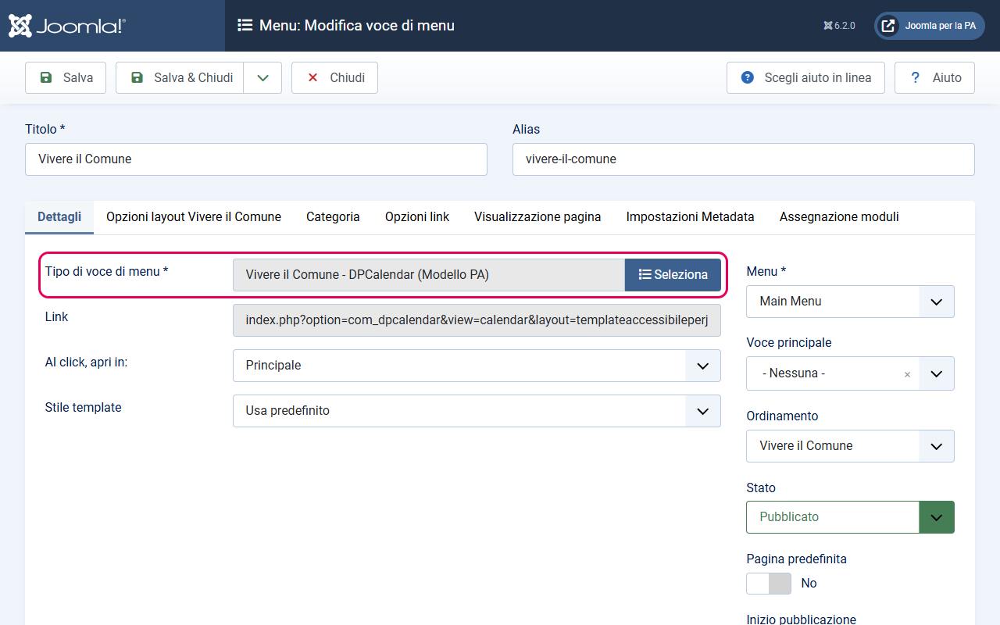
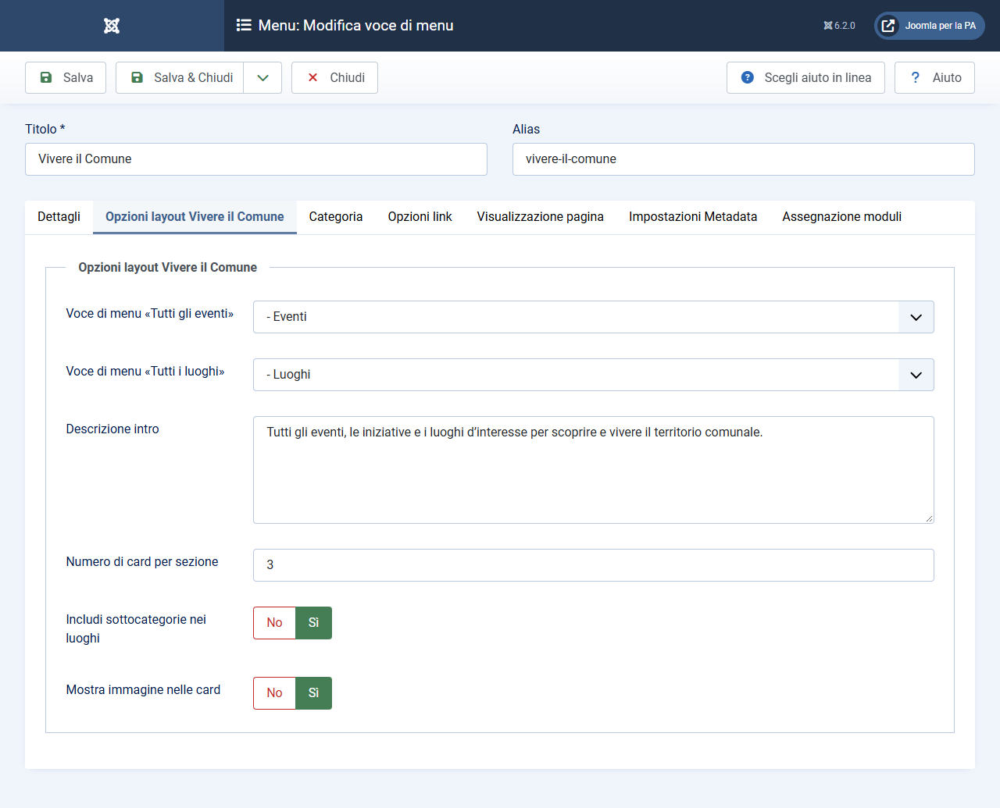
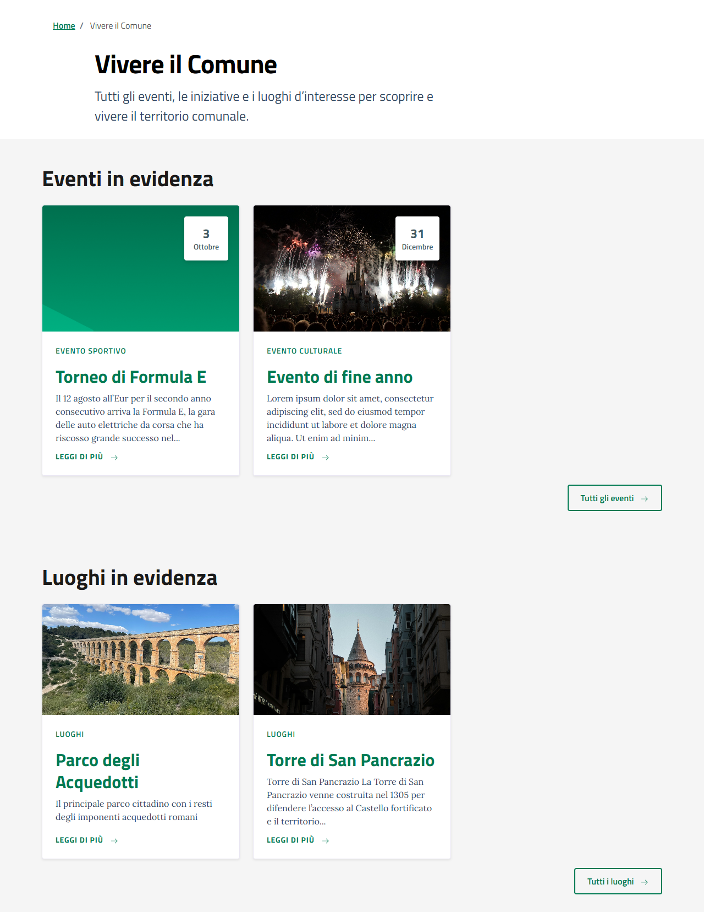
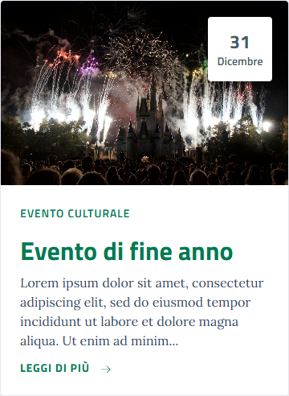

# Integrazione DPCalendar (Modello Comuni)

Questa documentazione spiega come utilizzare le funzionalità avanzate del template per integrare il componente **DPCalendar** seguendo il design pattern "Modello Comuni".

## 1. Pagina "Vivere il Comune" (DPCalendar)

È stata creata una view speciale che replica il layout "Vivere il Comune" (solitamente basato su articoli) utilizzando gli eventi e i luoghi di DPCalendar.

### Struttura dei Menu Consigliata
Per un funzionamento ottimale e una navigazione coerente, si consiglia la seguente gerarchia di menu:

1.  **Voce Principale**: "Vivere il Comune" (Tipo: *DPCalendar > Vivere il Comune - DPCalendar (Modello PA)*)
2.  **Sotto-voce "Eventi"**: (Tipo: *DPCalendar > Lista eventi*) - Utilizzata per mostrare l'elenco completo degli eventi.
3.  **Sotto-voce "Luoghi"**:
    *   *Opzione A (Articoli)*: (Tipo: *Articoli > Categoria Blog*) - Se i luoghi sono gestiti come articoli di Joomla.
    *   *Opzione B (DPCalendar)*: (Tipo: *DPCalendar > Visualizzazione delle località*) - Se si usa il sistema nativo di DPCalendar per la mappa dei luoghi.

### Creazione della voce di menu principale
Una volta create le sotto-voci "Eventi" e "Luoghi", procedi a configurare la voce principale:
1.  Vai in **Menu** -> **Crea nuova voce di menu**.
2.  Tipo di voce di menu: **DPCalendar** -> **Vivere il Comune - DPCalendar (Modello PA)**.

3.  Nella tab **Opzioni layout Vivere il Comune**, seleziona dalle tendine le due sotto-voci create in precedenza:
    *   **Voce di menu «Tutti gli eventi»**: seleziona la sotto-voce "Eventi".
    *   **Voce di menu «Tutti i luoghi»**: seleziona la sotto-voce "Luoghi".
    *   **Descrizione intro**: Un campo di testo libero (textarea) per inserire il testo che apparirà nella sezione "Hero" (testata) della pagina. Se compilato, sovrascrive la descrizione della categoria.
    *   **Numero di card per sezione**: Definisce quanti elementi mostrare (default: 3).
    *   **Includi sottocategorie nei luoghi**: Se attivo, gli articoli in evidenza vengono cercati anche nelle sottocategorie discendenti della categoria selezionata (valido solo quando "Tutti i luoghi" punta a una categoria `com_content`). Utile se la struttura delle categorie Luoghi ha più livelli.

### Funzionamento "Luoghi" Dinamici
Il layout implementa una logica intelligente per la sezione **Luoghi in evidenza**:
-   **Se la voce di menu "Tutti i luoghi" punta a DPCalendar**: Il sistema mostrerà i luoghi creati dentro DPCalendar.
-   **Se la voce di menu "Tutti i luoghi" punta a una Categoria di Articoli (com_content)**: Il sistema capisce che i luoghi sono gestiti come semplici articoli. Recupererà automaticamente gli articoli marcati come **"In evidenza"** (featured) da quella categoria e li mostrerà nel blocco dei luoghi, mantenendo la coerenza grafica.

### Requisiti per la visualizzazione
Per far apparire gli elementi nelle sezioni della pagina:
-   **Eventi**: Devono essere marcati come **"In evidenza"** (Featured) dentro DPCalendar.
-   **Luoghi (se articoli)**: Devono essere marcati come **"In evidenza"** (Featured) nella categoria selezionata.

---

## 2. Pagina "Lista eventi" (sotto-voce del menu)

Questa è la pagina a cui porta il pulsante "Tutti gli eventi" configurato nella voce principale "Vivere il Comune". Va creata come sotto-voce di menu separata, **prima** di configurare la voce principale.

### Tipo di voce di menu
**DPCalendar → Lista eventi (Modello PA)**

> Questo tipo di voce di menu attiva il layout specializzato `html/com_dpcalendar/list/eventi.php`
> del template, progettato secondo la sezione 5.3 di Designers Italia.

### Configurazione base (tab "Richiesto")
- **Calendari**: seleziona i calendari di eventi da includere. Consigliato: selezionare **Tutti** (valore `-1`).

### Configurazione date (tab "Opzioni")
Nei campi DPCalendar standard della tab **Opzioni**:
- **Data di inizio**: `now` — mostra solo eventi a partire da oggi
- **Data di fine**: `+365 day` — mostra eventi entro un anno da oggi

> Il valore `365` può essere aumentato o diminuito a piacere (es. `+180 day`, `+730 day`).
> In questo modo la lista si aggiorna automaticamente senza alcun intervento manuale.

### Parametri specifici del layout (tab "Opzioni layout lista eventi")

| Parametro | Descrizione | Default |
|-----------|-------------|---------|
| **Mostra fascia «In evidenza»** | Attiva il carousel Bootstrap Italia in cima, con gli eventi marcati "In evidenza" in DPCalendar | No |
| **Numero massimo card in evidenza** | Quante card mostrare nel carousel (3, 6 o 9). Visibile solo se la fascia è attiva. | 6 |
| **Mostra pulsante «Filtra»** | Mostra il form di ricerca e filtro (testo, calendario, intervallo di date) sopra la lista | Sì |
| **Mostra immagine nelle card** | Mostra l'immagine intro dell'evento nelle card della lista e del carousel | Sì |
| **Mostra calendario/categoria nelle card** | Mostra il nome del calendario sopra il titolo nelle card | Sì |
| **Mostra luogo nelle card** | Mostra il primo luogo dell'evento nel footer delle card della lista | Sì |
| **Ripeti gli eventi in evidenza anche nella lista** | Se attivo, gli eventi in evidenza compaiono sia nel carousel che nella lista sottostante. Se no (default), la lista mostra solo gli eventi non in evidenza. | No |
| **Tronca descrizione (caratteri)** | Numero massimo di caratteri della descrizione nelle card, seguito da «…». Imposta 0 per usare la lunghezza configurata in DPCalendar. | 0 |
| **Titolo pagina (h1)** | Titolo visualizzato come h1 nell'intestazione hero della pagina. Se vuoto, il blocco hero non appare. | — |
| **Descrizione pagina** | Testo descrittivo visualizzato sotto il titolo h1 nell'intestazione hero. Può contenere HTML di base. | — |

### Logica "In evidenza"
- Se **Mostra fascia «In evidenza»** è attivo ma nessun evento è marcato come featured in DPCalendar → il carousel non appare e la lista mostra tutti gli eventi normalmente.
- Per marcare un evento "In evidenza": apri l'evento nel backend DPCalendar → spunta **In evidenza** (Featured).

---

## 3. Pagina Singolo Evento ("Scheda Evento")

Il layout del singolo evento segue la tipologia "evento" del Modello Comuni. La guida completa, con i campi da creare e come associarli, è in **[Scheda Evento](scheda-evento.md)**.

### Struttura della pagina
-   **Intestazione**: calendario di appartenenza, titolo, date, testo introduttivo; a destra i menu **Condividi** e **Vedi azioni** (stampa, invio per email) e gli **Argomenti** (tag dell'evento).
-   **Immagine**: l'immagine completa dell'evento, a tutta larghezza.
-   **Sinistra (Indice)**: indice della pagina, che elenca solo le sezioni presenti.
-   **Destra (Contenuto)**: le sezioni, in ordine fisso: Cos'è, A chi è rivolto, Luogo, Date e orari, Costi, Prenotazione, Allegati, Contatti, Ulteriori informazioni.

### Sezione "Date e orari"
-   Mostra giorno e mese di inizio e fine con l'orario, e gestisce gli eventi "tutto il giorno".
-   Per gli eventi ricorrenti indica la regola di ricorrenza.
-   In fondo c'è il pulsante **Aggiungi al calendario** (Google Calendar o file .ics), se l'opzione di esportazione di DPCalendar è attiva.

### Funzionalità di DPCalendar integrate
-   **Mappa**: appare nella sezione "Luogo" se l'evento ha un luogo e la mappa è attiva.
-   **Prenotazioni**: se l'evento è prenotabile, modulo e pulsanti appaiono nella sezione "Prenotazione".
-   **Prezzi**: compaiono nella sezione "Costi".
-   **Organizzatori e autore**: compaiono nella sezione "Contatti".
-   **Serie**: gli eventi ricorrenti mostrano le altre date in "Ulteriori informazioni".

### Campi aggiuntivi DPCalendar
I campi personalizzati dell'evento possono essere associati a una sezione dai parametri del template (scheda **Scheda Evento**): vedi [Scheda Evento](scheda-evento.md).

I campi non associati vengono mostrati ciascuno come sezione a sé, con titolo e contenuto:
-   **URL o testo con un indirizzo YouTube o Vimeo**: il video viene incorporato.
-   **Subform con immagini**: viene mostrata una galleria.

---

## 4. Personalizzazioni CSS

Tutte le regole grafiche sono contenute nel file `css/template-comuni.css`. Sono stati aggiunti selettori specifici per garantire che:
-   Il testo della testata (Hero) abbia la dimensione corretta (**1.5rem**).
-   Le card degli eventi abbiano il "Leggi di più" allineato correttamente in basso.
-   Non ci siano sovrapposizioni tra il link della location e il pulsante di lettura.

---

## 5. FAQ / Debugging
-   **Perché non vedo eventi nella pagina Vivere?** Controlla di aver messo la spunta su "In evidenza" (Featured) nelle impostazioni dell'evento in DPCalendar.
-   **I luoghi non appaiono come articoli?** Verifica che la voce di menu scelta in "Tutti i luoghi" sia effettivamente di tipo "Categoria Blog" o "Lista" e che ci siano articoli "In evidenza" in quella categoria.
-   **La lista eventi è vuota?** Controlla che le date "Inizio" e "Fine" nella tab Opzioni siano impostate correttamente (`now` / `+365 day`). Se le date sono nel passato, nessun evento futuro apparirà.
-   **Il carousel "In evidenza" non appare?** Assicurati di aver attivato "Mostra fascia «In evidenza»" nelle opzioni del layout E che almeno un evento abbia la spunta "In evidenza" in DPCalendar.
-   **La lista mostra anche gli eventi già in evidenza nel carousel?** Di default la lista mostra solo gli eventi NON in evidenza. Per mostrarli anche nella lista, attiva "Ripeti gli eventi in evidenza anche nella lista".
-   **La sezione "Luoghi" mostra articoli di categorie che non ho selezionato?** Era un bug SQL risolto nella versione corrente. Se aggiorni da una versione precedente e il problema persiste, svuota la cache di Joomla e verifica che il file `html/com_dpcalendar/calendar/vivere.php` sia aggiornato.
-   **Voglio mostrare luoghi da più sottocategorie (es. Musei, Parchi, Impianti Sportivi come figli di "Luoghi")?** Attiva il parametro **"Includi sottocategorie nei luoghi"** nella tab "Opzioni layout Vivere il Comune". Il sistema recupera automaticamente tutti gli articoli in evidenza da qualsiasi livello di sottocategoria discendente dalla categoria radice selezionata.
