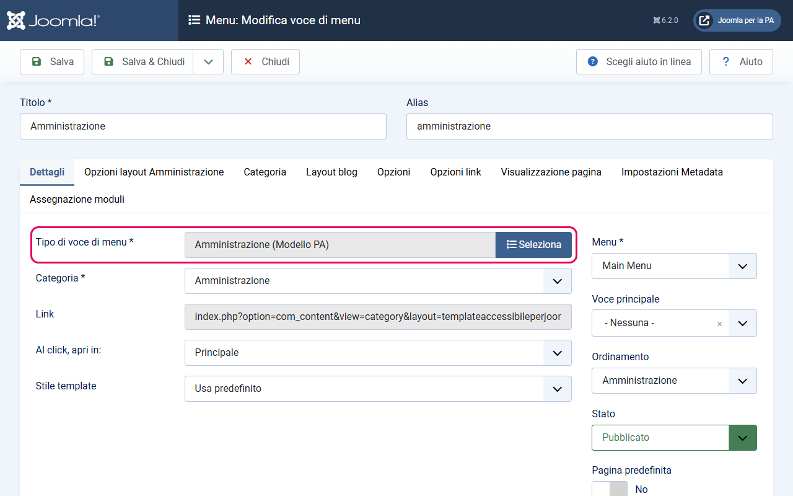
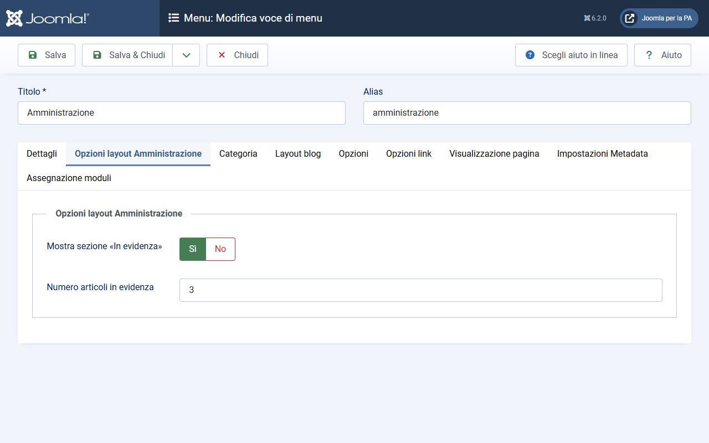
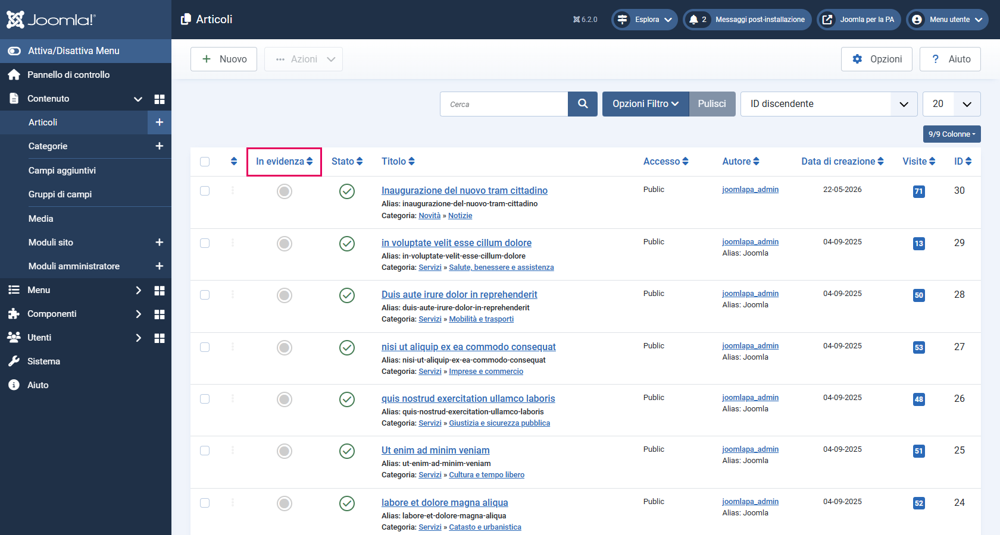
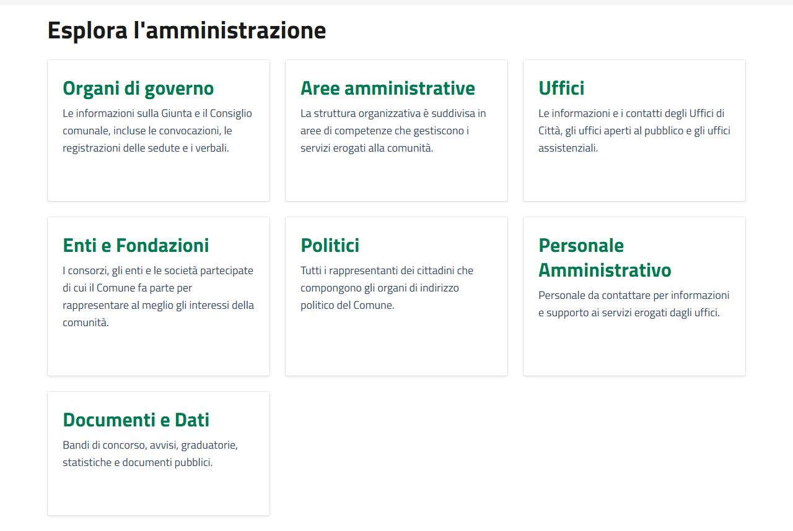

# Layout Categoria Amministrazione

> **Modello Comuni** — Questa guida è specifica per i siti web dei Comuni italiani.

Il layout `amministrazione` è il layout specializzato per la categoria **Amministrazione** del Modello Comuni. Mostra un'intestazione (hero), una sezione di articoli "In evidenza" su sfondo grigio e l'elenco delle sottocategorie con i link necessari per la validazione automatica.

---

## Cosa fa questo layout

La pagina generata da questo layout è strutturata così, dall'alto verso il basso:

1. **Hero** — titolo della categoria, descrizione e tag (se presenti)
2. **Sezione "In evidenza"** *(solo sulla prima pagina)* — articoli marcati come "In evidenza" della categoria e delle sottocategorie, mostrati su sfondo grigio
3. **Sezione "Esplora l'amministrazione"** — sottocategorie di secondo livello con link che portano alle rispettive pagine. Ogni link ha l'attributo `data-element="management-category-link"`, richiesto dal criterio C.SI.1.7 del Modello Comuni.

---

## Come attivare il layout

Il layout si assegna alla **voce di menu** che punta alla categoria Amministrazione, non alla categoria stessa.

1. Vai su **Menu → [il tuo menu principale] → Nuovo**
2. In **Tipo di voce di menu**, clicca **Seleziona** e scegli **Articoli → Amministrazione (Modello PA)**: il layout del template compare nell'elenco come un tipo di voce a sé
3. Nel campo **Categoria**, seleziona la categoria **Amministrazione**
4. Salva

---

## Parametri configurabili

Nella stessa voce di menu, alla scheda **Opzioni layout Amministrazione**, trovi due parametri specifici di questo layout:

| Parametro | Descrizione | Default |
|-----------|-------------|---------|
| Mostra sezione «In evidenza» | Se impostato su Sì, mostra la sezione con gli articoli in evidenza in cima alla pagina (solo pagina 1) | Sì |
| Numero articoli in evidenza | Quanti articoli in evidenza mostrare (da 1 a 12) | 3 |

**Come configurarli:**
1. Modifica la voce di menu della categoria Amministrazione
2. Clicca sulla scheda **Opzioni layout Amministrazione**
3. Modifica i valori desiderati
4. Salva

---

## Come popolare la sezione "In evidenza"

La sezione "In evidenza" mostra automaticamente gli articoli marcati come "In evidenza" (`featured = 1`) nella categoria **Amministrazione** e in tutte le sue **sottocategorie**. La ricerca è ricorsiva: un articolo in evidenza in "Uffici" (sottocategoria di Amministrazione) apparirà nella sezione "In evidenza" della pagina Amministrazione.

Gli articoli vengono ordinati per data di pubblicazione decrescente (i più recenti prima).

**Come marcare un articolo come "In evidenza":**
- Dalla lista articoli (**Contenuto → Articoli**): clicca la stella nella colonna **In Evidenza**
- Oppure dall'editor articolo: scheda **Contenuto**, colonna destra → **In evidenza**: **Sì**

---

## Come funzionano le sottocategorie (Esplora l'amministrazione)

La sezione "Esplora l'amministrazione" mostra le **sottocategorie dirette** della categoria Amministrazione. Per il Modello Comuni, le sottocategorie previste sono:

- Organi di governo
- Aree amministrative
- Uffici
- Enti e Fondazioni
- Politici
- Personale Amministrativo
- Documenti e Dati

Ogni link a sottocategoria ha l'attributo `data-element="management-category-link"`, verificato automaticamente dall'App Valutazione Modelli per il criterio C.SI.1.7.

**Non è necessaria nessuna configurazione aggiuntiva**: le sottocategorie compaiono automaticamente se esistono e sono pubblicate. Se vuoi aggiungere una nuova sottocategoria, creala in Joomla come figlia di "Amministrazione" e apparirà automaticamente.

---

## Note

- La sezione "In evidenza" appare **solo sulla prima pagina** della paginazione. Se l'utente naviga alle pagine successive, la sezione non viene ripetuta.
- Se nessun articolo è marcato come "In evidenza" nella categoria, la sezione "In evidenza" non appare (anche se il parametro è impostato su Sì).
- Se la categoria Amministrazione non ha sottocategorie, la sezione "Esplora l'amministrazione" non appare.
