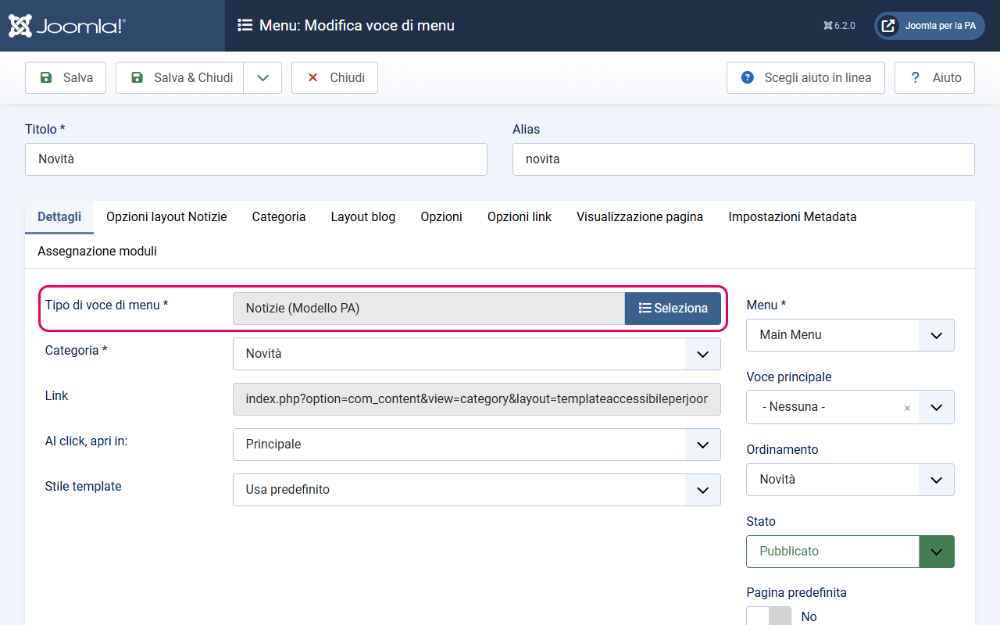
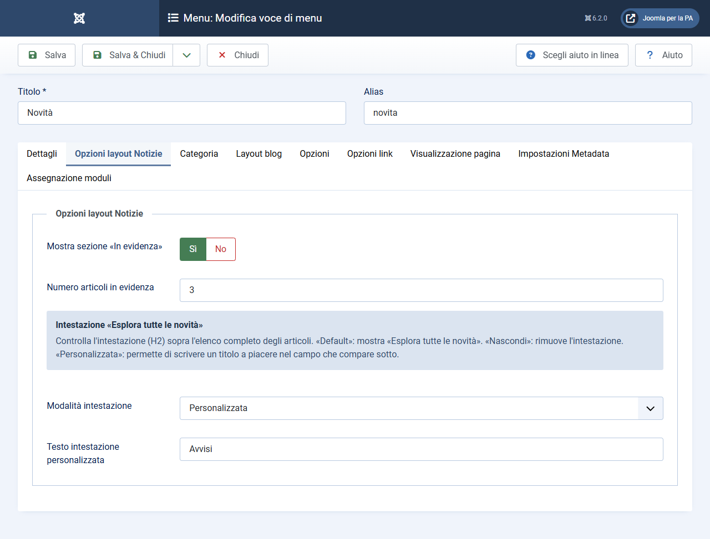
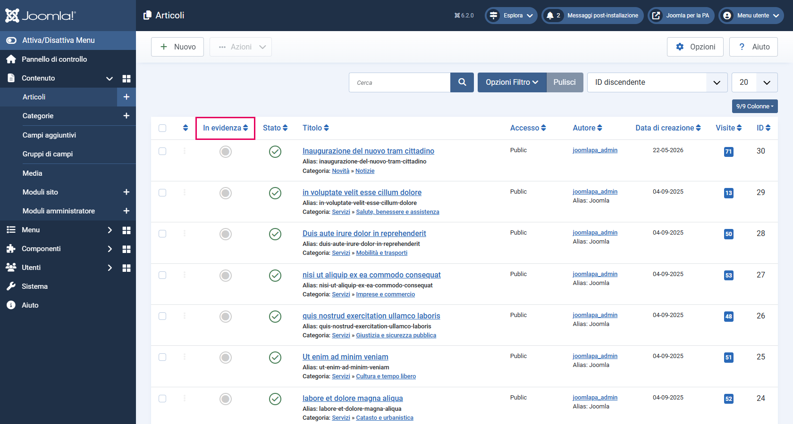
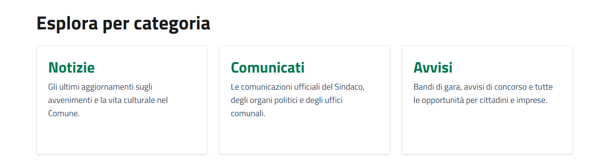

# Layout Categoria Notizie

> **Modello Comuni** — Questa guida è specifica per i siti web dei Comuni italiani.

Il layout `notizie` è il layout specializzato per la sezione **Novità** del Modello Comuni. Mostra le notizie più recenti, con una sezione in cima dedicata agli articoli "in evidenza".

---

## Cosa fa questo layout

La pagina generata da questo layout è strutturata così, dall'alto verso il basso:

1. **Hero** — titolo della categoria, descrizione e tag (se presenti e configurati)
2. **Sezione "In evidenza"** *(solo sulla prima pagina, se abilitata)* — articoli marcati come "In evidenza" della categoria, ordinati dalla data più recente
3. **Sezione "Esplora tutte le novità"** — lista di tutti gli articoli con paginazione, sempre visibile
4. **Sezione "Esplora per categoria"** *(solo se la categoria ha sottocategorie)* — link alle sottocategorie (es. Notizie, Comunicati, Avvisi)

---

## Come attivare il layout

Il layout si assegna alla **voce di menu** che punta alla categoria, non alla categoria stessa.

Puoi assegnare questo layout sia alla categoria radice **Novità** che a una sottocategoria specifica come **Notizie**, **Comunicati** o **Avvisi**.

1. Vai su **Menu → [il tuo menu] → Nuovo**
2. In **Tipo di voce di menu**, clicca **Seleziona** e scegli **Articoli → Notizie (Modello PA)**: il layout del template compare nell'elenco come un tipo di voce a sé
3. Nel campo **Categoria**, seleziona la categoria desiderata (es. `Novità` oppure `Notizie`)
4. Salva

---

## Parametri configurabili

Nella stessa voce di menu, alla scheda **Opzioni layout Notizie**, trovi i parametri specifici di questo layout:

| Parametro | Descrizione | Default |
|-----------|-------------|---------|
| Mostra sezione «In evidenza» | Se Sì, mostra la sezione con le notizie in evidenza in cima (solo pagina 1) | Sì |
| Numero notizie in evidenza | Quante notizie in evidenza mostrare (da 1 a 12) | 3 |
| Modalità intestazione | Controlla il titolo (H2) sopra l'elenco completo: **Default** mostra «Esplora tutte le novità», **Nascondi** lo rimuove, **Personalizzata** usa un testo a scelta | Default |
| Testo intestazione personalizzata | Il titolo da mostrare al posto di «Esplora tutte le novità» | — |

Il campo **Numero notizie in evidenza** è visibile solo se **Mostra sezione «In evidenza»** è impostato su Sì. Il campo **Testo intestazione personalizzata** è visibile solo se **Modalità intestazione** è impostata su Personalizzata.

**Come configurarli:**
1. Modifica la voce di menu della categoria Notizie
2. Clicca sulla scheda **Opzioni layout Notizie**
3. Modifica i valori
4. Salva

---

## Come popolare la sezione "In evidenza"

La sezione "In evidenza" mostra automaticamente gli articoli marcati come "In evidenza" (`featured = 1`) della categoria associata alla voce di menu. Gli articoli vengono ordinati per **data di pubblicazione decrescente** (le notizie più recenti prima).

**Come marcare una notizia come "In evidenza":**
- Dalla lista articoli (**Contenuto → Articoli**): clicca la stella nella colonna **In Evidenza**
- Oppure dall'editor articolo: scheda **Contenuto**, colonna destra → **In evidenza**: **Sì**

**Attenzione:** la sezione "In evidenza" appare **solo sulla prima pagina** della paginazione. Se l'utente va alle pagine successive, la sezione non viene ripetuta.

---

## Come funzionano le sottocategorie

Se la categoria associata alla voce di menu ha sottocategorie (es. la categoria "Novità" ha le sottocategorie "Notizie", "Comunicati", "Avvisi"), il layout mostra automaticamente in fondo alla pagina una sezione con i link alle sottocategorie.

Non serve nessuna configurazione: basta che le sottocategorie esistano e siano pubblicate.

---

## Nota sui data-element

A differenza del layout Servizi, il layout Notizie non emette `data-element` specifici sulle singole card delle notizie: il Modello Comuni non richiede attributi particolari per gli articoli di notizie individuali.

Il layout emette però `data-element` sulle sottocategorie (se presenti), per soddisfare eventuali requisiti di navigazione.
