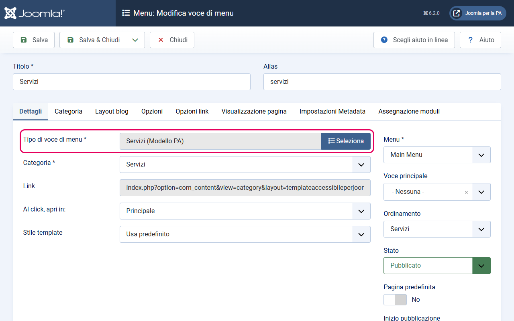
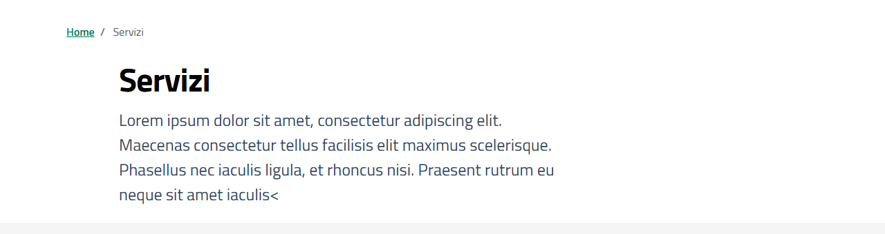
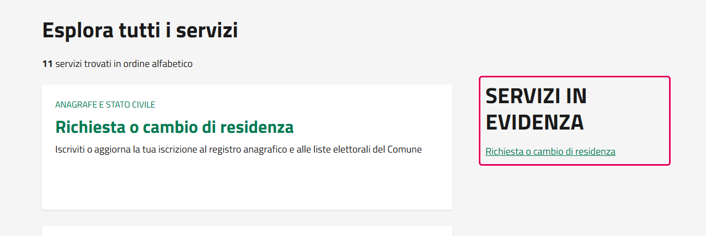
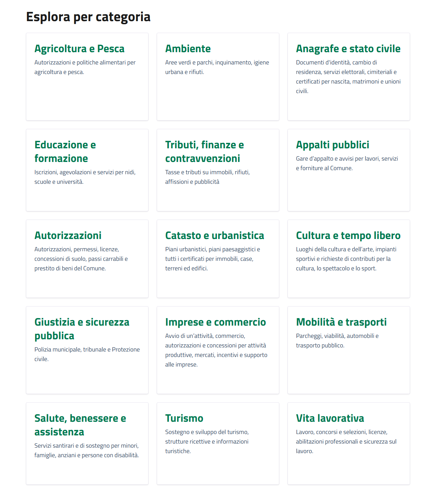

# Layout Categoria Servizi

> **Modello Comuni** — Questa guida è specifica per i siti web dei Comuni italiani.

Il layout `servizi` è il layout specializzato per la categoria **Servizi** del Modello Comuni. Risponde al criterio C.SI.1.3 dell'App Valutazione Modelli, che richiede che i link ai servizi e alle categorie di servizi abbiano specifici attributi `data-element`.

---

## Cosa fa questo layout

La pagina generata da questo layout è strutturata così:

1. **Hero** — titolo della categoria, descrizione e tag (se presenti)
2. **Colonna principale (sinistra)** — area di ricerca, contatore articoli, lista dei servizi con paginazione
3. **Colonna destra — Servizi in evidenza** — sidebar con i servizi marcati come "In evidenza"
4. **Sezione sottocategorie** *(solo se la categoria ha sottocategorie)* — link alle sottocategorie dei servizi

---

## Come attivare il layout

Il layout si assegna alla **voce di menu** che punta alla categoria Servizi.

1. Vai su **Menu → [il tuo menu principale] → Nuovo**
2. In **Tipo di voce di menu**, clicca **Seleziona** e scegli **Articoli → Servizi (Modello PA)**: il layout del template compare nell'elenco come un tipo di voce a sé
3. Nel campo **Categoria**, seleziona la categoria **Servizi**
4. Salva

Puoi applicare questo layout anche alle **sottocategorie** di Servizi (es. la pagina della categoria "Ambiente" può avere il layout Servizi e mostrare la lista dei servizi ambientali).

---

## Sezioni della pagina

### Hero

La hero mostra il titolo della categoria, la descrizione (se presente e abilitata nelle opzioni della voce di menu) e i tag della categoria (se abilitati).

Per aggiungere una descrizione alla categoria Servizi:
1. Vai su **Contenuto → Categorie** e modifica la categoria "Servizi"
2. Nel campo **Descrizione**, inserisci il testo
3. Salva

### Colonna principale — Lista servizi

La colonna principale (circa 2/3 della larghezza su desktop) contiene:

- **Area di ricerca** — posizione modulo `cerca-servizi` (facoltativa). Se nessun modulo è pubblicato in quella posizione, l'area non appare.
- **Contatore** — "N servizi trovati" (dove N è il numero totale di articoli nella categoria)
- **Lista dei servizi** — ogni articolo è mostrato come voce con titolo e link. Il link ha l'attributo `data-element="service-link"`, richiesto dall'App Valutazione Modelli.
- **Paginazione** — se ci sono più articoli di quanti ne mostra la pagina

### Sidebar destra — Servizi in evidenza

La colonna destra (circa 1/3 della larghezza su desktop) mostra automaticamente i servizi marcati come "In evidenza" (`featured = 1`) della categoria corrente **e di tutte le sue sottocategorie**. Ogni link ha l'attributo `data-element="service-link"`.

Questo significa che se sei nella pagina della categoria radice "Servizi", la sidebar mostra i servizi in evidenza di tutte le sottocategorie (Ambiente, Tributi, Anagrafe, ecc.). Se sei in una sottocategoria specifica, mostra solo quelli di quella sottocategoria e delle sue figlie.

**Come aggiungere un servizio alla sidebar:**
- Dalla lista articoli: clicca la stella nella colonna **In Evidenza** dell'articolo
- Oppure dall'editor articolo: scheda **Contenuto**, colonna destra → **In evidenza**: **Sì**

### Sezione "Esplora per categoria"

Se la categoria ha sottocategorie (es. "Ambiente", "Tributi", ecc.), in fondo alla pagina appare automaticamente una sezione con i link alle sottocategorie. Ogni link ha l'attributo `data-element="service-category-link"`, richiesto dall'App Valutazione Modelli.

Non serve configurazione: le sottocategorie pubblicate compaiono automaticamente.

---

## Aggiungere la ricerca (posizione `cerca-servizi`)

Per aggiungere una barra di ricerca in cima alla lista dei servizi, pubblica un modulo **Motore di ricerca** (Smart Search) nella posizione `cerca-servizi`. Il modulo è già incluso in Joomla.

1. Prima di tutto, crea l'indice: **Componenti → Motore di ricerca → Indice** → clicca **Indice** (i dettagli sono in [ricerca.md](ricerca.md))
2. Vai su **Contenuto → Moduli sito → Nuovo** e seleziona **Motore di ricerca**
3. Nella scheda **Modulo** → **Posizione** (colonna destra): inserisci `cerca-servizi`
4. Nelle opzioni del modulo puoi limitare la ricerca alla sola categoria Servizi
5. Pubblica il modulo

---

## Data-element emessi

Questi attributi sono richiesti dall'App Valutazione Modelli per la verifica automatica del criterio C.SI.1.3:

| Elemento | data-element | Dove appare |
|----------|-------------|-------------|
| Link a un articolo servizio | `service-link` | Lista articoli e sidebar "In evidenza" |
| Link a una sottocategoria | `service-category-link` | Sezione "Esplora per categoria" |
