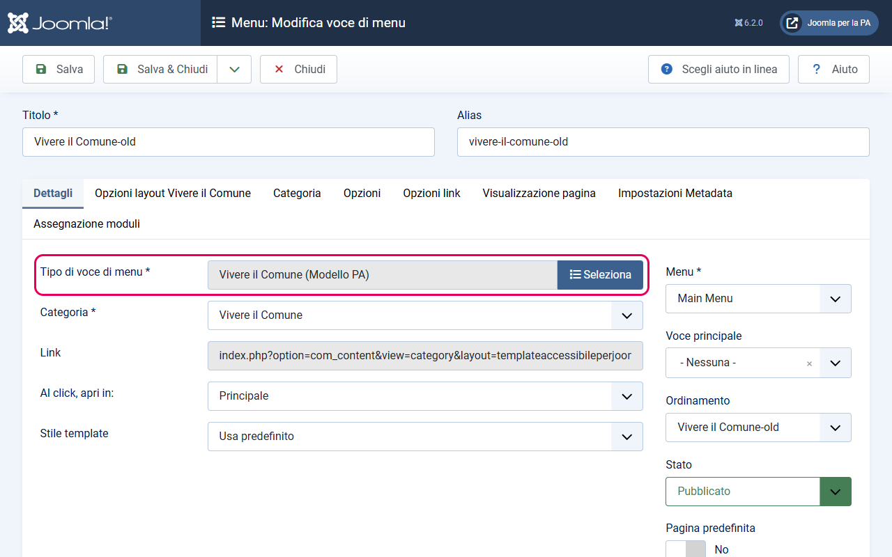
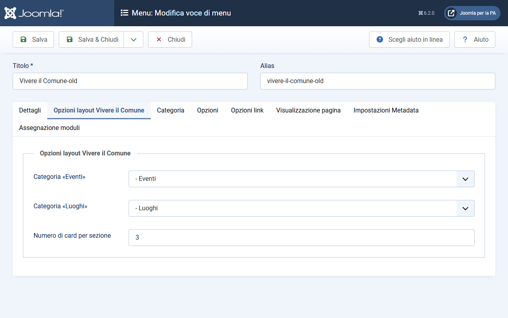
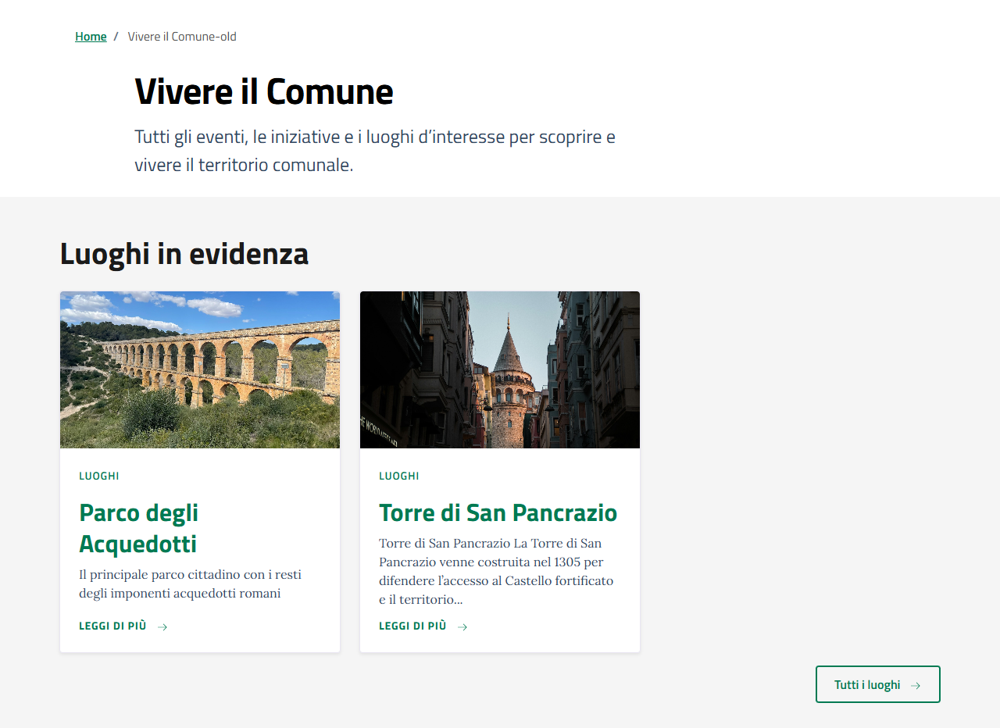

# Layout Categoria Vivere il Comune

> ⚠️ **Attenzione — due approcci disponibili per la sezione "Vivere il Comune"**
>
> Questa guida spiega come gestire eventi e luoghi tramite **articoli nativi di Joomla**.
> Questo approccio è semplice da configurare, ma ha limitazioni importanti:
> - **Nessun calendario interattivo** — le date mostrate sono solo la data di pubblicazione dell'articolo
> - **Nessuna mappa** — i luoghi non hanno coordinate geografiche native
> - **Nessun ordinamento per data reale** dell'evento — gli articoli sono ordinati per data di pubblicazione
> - **Nessuna prenotazione** — funzione non disponibile con i soli articoli Joomla
>
> Se vuoi una gestione avanzata degli eventi con **calendario, mappe, prenotazioni e ordine cronologico reale degli eventi**, usa invece l'integrazione con **DPCalendar** (componente gratuito di terze parti):
>
> **→ [Integrazione DPCalendar (Modello Comuni)](integrazione-DPCalendar.md)**

> **Modello Comuni** — Questa guida è specifica per i siti web dei Comuni italiani.

Il layout `vivere` è il layout specializzato per la pagina **Vivere il Comune** del Modello Comuni. Mostra due sezioni parallele: una con gli eventi in evidenza e una con i luoghi in evidenza. I link e i pulsanti generati hanno gli attributi `data-element` richiesti dall'App Valutazione Modelli.

---

## Cosa fa questo layout

La pagina generata da questo layout è strutturata così:

1. **Hero** — titolo della categoria, descrizione e tag (se presenti)
2. **Sezione "Eventi in evidenza"** *(appare solo se la categoria eventi è configurata e ha articoli in evidenza)* — card degli eventi con immagine, badge data, titolo e testo introduttivo
3. **Sezione "Luoghi in evidenza"** *(appare solo se la categoria luoghi è configurata e ha articoli in evidenza)* — card dei luoghi con immagine, titolo e testo introduttivo

Ogni sezione termina con un pulsante "Tutti gli eventi" / "Tutti i luoghi" che porta alla pagina di lista della categoria corrispondente.

---

## Prerequisiti

Prima di configurare il layout, assicurati di aver creato:
- La categoria **Vivere il Comune** con le due sottocategorie **Eventi** e **Luoghi**
- Almeno un articolo nella categoria **Eventi** marcato come "In evidenza"
- Almeno un articolo nella categoria **Luoghi** marcato come "In evidenza"

Se una delle due categorie non ha articoli in evidenza, la sezione corrispondente non appare.

---

## Come attivare il layout

Il layout si assegna alla **voce di menu** che punta alla categoria Vivere il Comune.

1. Vai su **Menu → [il tuo menu principale] → Nuovo**
2. In **Tipo di voce di menu**, clicca **Seleziona** e scegli **Articoli → Vivere il Comune (Modello PA)**: il layout del template compare nell'elenco come un tipo di voce a sé
3. Nel campo **Categoria**, seleziona la categoria **Vivere il Comune**
4. Prima di salvare, configura i parametri nella scheda dedicata (vedi sotto)
5. Salva

---

## Parametri configurabili

Nella scheda **Opzioni layout Vivere il Comune** della voce di menu, trovi i parametri specifici di questo layout:

| Parametro | Descrizione | Default |
|-----------|-------------|---------|
| Categoria «Eventi» | Seleziona la categoria Joomla degli eventi. Il layout mostrerà gli articoli in evidenza di questa categoria. | — |
| Categoria «Luoghi» | Seleziona la categoria Joomla dei luoghi. Il layout mostrerà gli articoli in evidenza di questa categoria. | — |
| Numero di card per sezione | Quante card mostrare nella sezione "In evidenza" per eventi e luoghi | 3 |

**Come configurarli:**
1. Modifica la voce di menu della categoria Vivere il Comune
2. Clicca sulla scheda **Opzioni layout Vivere il Comune**
3. Nel campo **Categoria «Eventi»**, seleziona la categoria **Eventi** dal menu a tendina
4. Nel campo **Categoria «Luoghi»**, seleziona la categoria **Luoghi** dal menu a tendina
5. Nel campo **Numero di card per sezione**, inserisci quante card vuoi (default: 3)
6. Salva

---

## Come popolare le sezioni

### Card eventi

Le card degli eventi vengono popolate dagli articoli marcati come "In evidenza" della categoria **Eventi** (o della categoria che hai selezionato nel parametro). Gli articoli vengono ordinati per **data di pubblicazione decrescente** (gli eventi più recenti prima).

Ogni card mostra:
- **Immagine** — l'immagine introduttiva dell'articolo (se presente). In alto a destra sull'immagine appare un **badge con il giorno e il mese** estratti dalla data di pubblicazione dell'articolo.
- **Categoria** — il nome della categoria dell'articolo
- **Titolo** — con link all'articolo, ha l'attributo `data-element="live-category-link"`
- **Testo introduttivo** — troncato a 150 caratteri

**Come marcare un evento come "In evidenza":**
- Dalla lista articoli: clicca la stella nella colonna **In Evidenza**
- Oppure dall'editor articolo: scheda **Contenuto**, colonna destra → **In evidenza**: **Sì**

**Come impostare l'immagine dell'evento:**
- Nell'editor articolo, scheda **Immagini e link** → campo **Immagine introduttiva**: carica o seleziona l'immagine
- Nel campo **Testo alternativo immagine**: inserisci una descrizione dell'immagine (obbligatorio per l'accessibilità)

**Come impostare la data dell'evento:**
- La data mostrata nel badge è la **data di pubblicazione** dell'articolo. Per impostare una data specifica: nell'editor articolo, scheda **Pubblicazione** → campo **Inizia la pubblicazione**: inserisci la data dell'evento.

### Card luoghi

Le card dei luoghi funzionano in modo analogo agli eventi, ma:
- Non mostrano il badge con la data (i luoghi non hanno tipicamente una data specifica)
- Mostrano: immagine, categoria, titolo (con link `data-element="live-category-link"`), testo introduttivo troncato

---

## Pulsanti "Tutti gli eventi" e "Tutti i luoghi"

In fondo a ogni sezione appare un pulsante che porta alla pagina di lista della categoria:

- **"Tutti gli eventi"** → punta alla categoria **Eventi** (il link è generato automaticamente dalla categoria configurata nel parametro). Ha `data-element="live-button-events"`.
- **"Tutti i luoghi"** → punta alla categoria **Luoghi**. Ha `data-element="live-button-locations"`.

Questi pulsanti appaiono anche se la sezione non ha articoli in evidenza? No: se non ci sono articoli in evidenza, l'intera sezione (incluso il pulsante) non viene mostrata.

---

## Data-element emessi

Questi attributi sono richiesti dall'App Valutazione Modelli:

| Elemento | data-element |
|----------|-------------|
| Link titolo articolo (eventi e luoghi) | `live-category-link` |
| Pulsante "Tutti gli eventi" | `live-button-events` |
| Pulsante "Tutti i luoghi" | `live-button-locations` |

