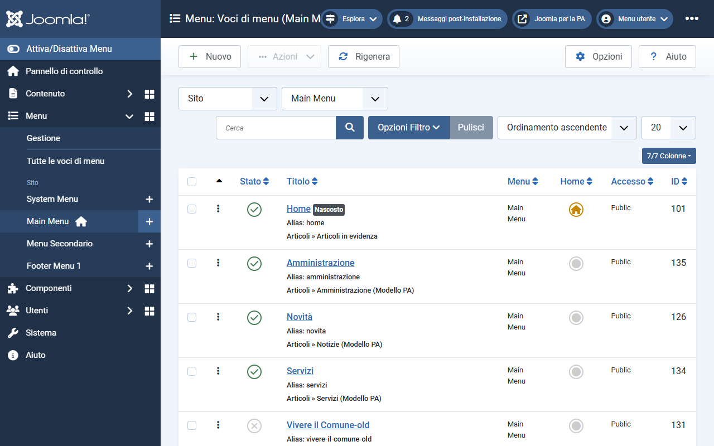
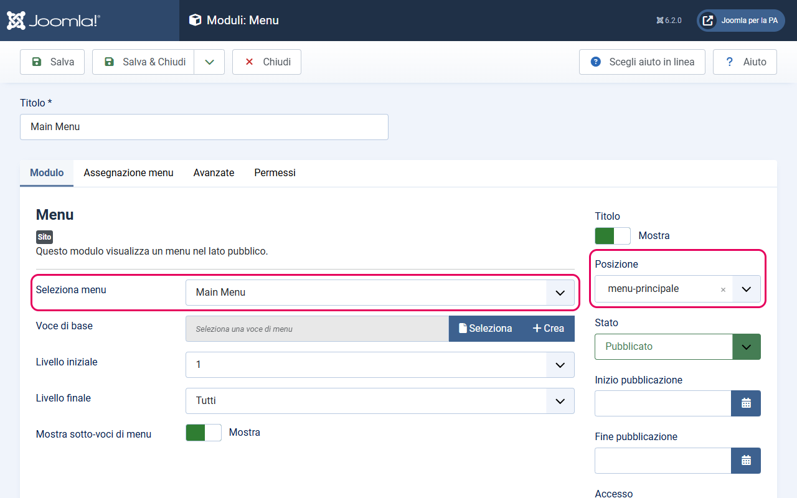
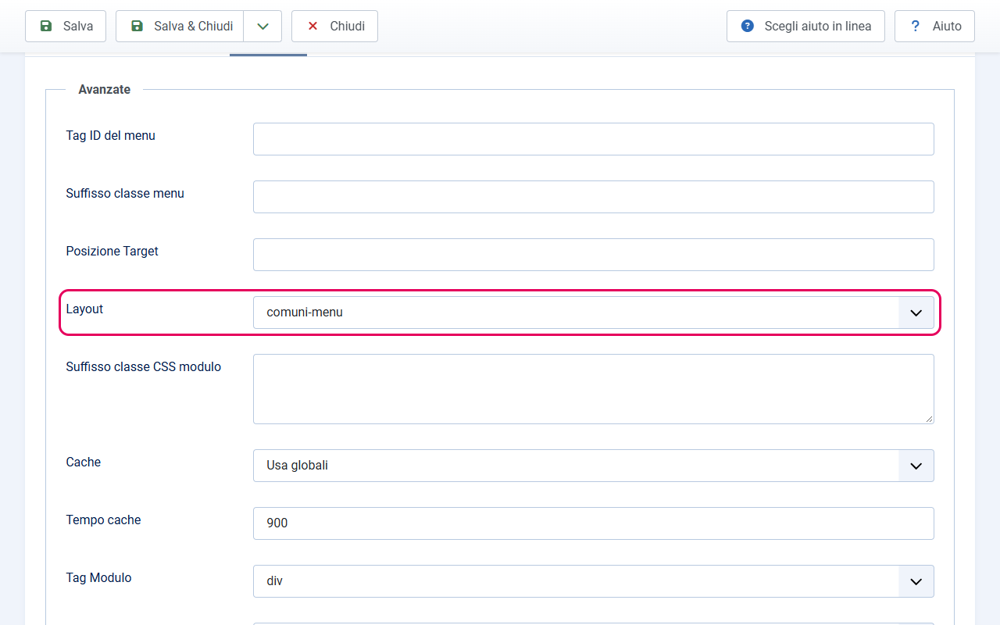
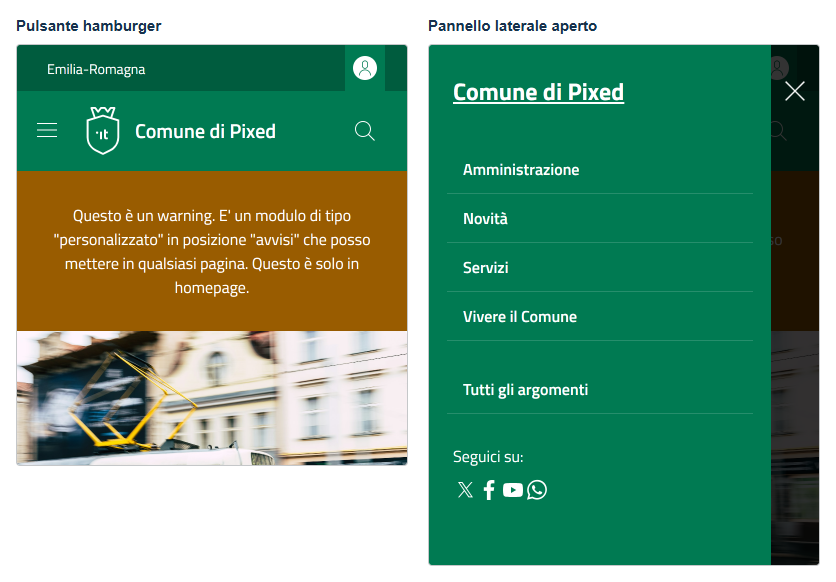

# Menu di navigazione

Il template prevede due posizioni per i menu di navigazione nell'header: `menu-principale` e `menu-secondario`. Entrambe richiedono un passaggio specifico: il layout alternativo `comuni-menu`.

---

## Prima di iniziare

Assicurati di aver già creato almeno un menu in Joomla con le voci di menu necessarie. Se non l'hai ancora fatto:

1. Vai su **Menu → Gestione** e clicca **Nuovo**
2. Dai un nome al menu (es. `Menu principale`)
3. Salva, poi aggiungi le voci di menu da **Menu → [Nome menu]** con il pulsante **Nuovo**

---

## Perché serve il layout `comuni-menu`

Joomla genera l'HTML dei moduli menu in modo generico. Il template Bootstrap Italia richiede una struttura HTML specifica (con classi e attributi precisi) per il menu dell'header. Il layout alternativo `comuni-menu` è incluso nel template e produce esattamente quella struttura.

Se usi il layout default di Joomla invece di `comuni-menu`, il menu appare nell'header ma **non funziona correttamente**: le voci potrebbero non essere formattate, i menu a tendina potrebbero non aprirsi, e la navigazione su mobile non funzionerà.

---

## Come creare un modulo menu con il layout `comuni-menu`

Ripeti questi passaggi sia per il menu principale che per il menu secondario.

1. Vai su **Contenuto → Moduli sito → Nuovo**
2. Nella lista dei tipi di modulo, seleziona **Menu**

3. Nella scheda **Modulo** del nuovo modulo, compila:
   - **Titolo**: inserisci un titolo descrittivo (es. `Menu Principale`). Puoi nasconderlo dal frontend con l'interruttore **Titolo** (Mostra/Nascondi), nella colonna destra.
   - **Seleziona menu**: scegli il menu Joomla che vuoi mostrare (es. `Menu principale`)
   - **Posizione** (colonna destra): digita o seleziona `menu-principale` (per il menu principale) oppure `menu-secondario` (per il menu secondario)

4. Nella scheda **Assegnazione menu**: scegli **Su tutte le pagine** (o le pagine specifiche dove vuoi il menu)

5. Nella scheda **Avanzate**:
   - **Layout**: clicca sul menu a tendina e seleziona `comuni-menu`

6. Imposta lo **Stato** su *Pubblicato*

7. Clicca **Salva e chiudi**

---

## Differenza tra menu principale e menu secondario

| Posizione | Descrizione | Uso tipico |
|-----------|-------------|------------|
| `menu-principale` | Navigazione orizzontale principale nella navbar | Link alle sezioni principali: Amministrazione, Notizie, Servizi, Vivere il Comune |
| `menu-secondario` | Navigazione secondaria accanto al menu principale | Link rapidi: Novità, Contatti, FAQ |

Entrambe le posizioni si trovano nella stessa barra (navbar) nell'header. La differenza è principalmente visiva e semantica.

*1 — Menu principale (posizione `menu-principale`) · 2 — Menu secondario (posizione `menu-secondario`)*

---

## Comportamento su mobile

Su schermi piccoli (smartphone), la navbar mostra solo un pulsante hamburger (tre linee orizzontali). Cliccandolo si apre un pannello laterale che contiene entrambi i menu (principale e secondario).

---

## Note

- **Layout obbligatorio**: il layout `comuni-menu` è obbligatorio. Senza di esso la struttura HTML per Bootstrap Italia non viene generata correttamente e il menu non funziona.
- **Stesso menu in entrambe le posizioni**: è possibile assegnare lo stesso menu Joomla sia a `menu-principale` che a `menu-secondario`. In quel caso lo stesso menu appare in entrambe le posizioni.
- **Tipo di voci**: non ci sono limitazioni sul tipo di voci di menu che puoi usare — URL esterni, articoli, categorie, alias di menu, ecc.
- **Menu a tendina (dropdown)**: le voci con sottovoci vengono automaticamente convertite in menu a tendina da Bootstrap Italia grazie al layout `comuni-menu`. Aggiungi semplicemente voci figlie nel backend di Joomla.
