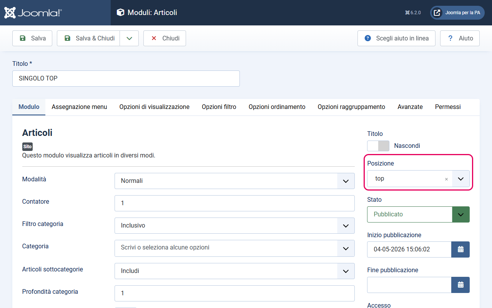
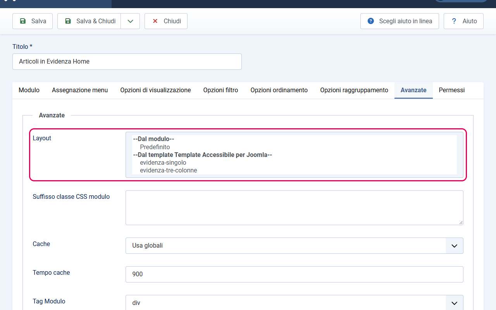

# Posizioni modulo

Il template definisce una serie di posizioni fisse dove puoi inserire i moduli Joomla. Ogni posizione corrisponde a un'area specifica della pagina.

Per assegnare un modulo a una posizione, apri il modulo in modifica: nella scheda **Modulo**, colonna destra, trovi il campo **Posizione**.

---

## Mappa delle posizioni

### Topbar (banda slim superiore)

| Posizione | Area nella pagina | Uso tipico |
|-----------|-------------------|------------|
| `selezione-lingua` | Destra della banda slim | Modulo cambio lingua (`mod_languages`) per siti multilingua |

### Header — Navbar

| Posizione | Area nella pagina | Uso tipico |
|-----------|-------------------|------------|
| `menu-principale` | Navbar a sinistra | Menu di navigazione principale — **obbligatorio il layout `comuni-menu`** |
| `menu-secondario` | Navbar a destra | Menu di navigazione secondario — **obbligatorio il layout `comuni-menu`** |

### Avvisi

| Posizione | Area nella pagina | Uso tipico |
|-----------|-------------------|------------|
| `avvisi` | Subito sotto l'intestazione, a tutta larghezza, prima del breadcrumb | Banner di comunicazione: manutenzioni, disservizi, allerte |

Colori e uso di più banner sono descritti in [avvisi.md](avvisi.md).

### Breadcrumb (percorso di navigazione)

| Posizione | Area nella pagina | Uso tipico |
|-----------|-------------------|------------|
| `percorso` | Sotto la navbar, sopra il contenuto | Modulo breadcrumb (`mod_breadcrumbs`) |

**Nota sul breadcrumb:** il template include un override del modulo `mod_breadcrumbs` che applica automaticamente la struttura Bootstrap Italia. Basta assegnare il modulo alla posizione `percorso` — non è necessario selezionare un layout alternativo.

### Area contenuto principale

Queste posizioni si trovano attorno all'area principale della pagina (la parte che cambia in base alla voce di menu). Sono elencate nell'ordine in cui compaiono, dall'alto verso il basso.

| Posizione | Area nella pagina | Sfondo | Uso tipico |
|-----------|-------------------|--------|------------|
| `top` | Sotto il breadcrumb, prima di tutte le altre | Bianco | Contenuto in primo piano, hero o carosello |
| `calendario` | Sotto `top` | Bianco | Moduli calendario o eventi |
| `evidenza` | Sotto `calendario`, sopra il contenuto | Immagine + colore primario | Card con gli articoli in evidenza |
| `top-muted` | Sotto `evidenza`, sopra il contenuto | Grigio chiaro | Sezioni di supporto |
| `bottom` | Sotto il contenuto principale | Colore primario | Call to action, prossimi eventi |
| `bottom2` | Sotto `bottom` | Grigio chiaro | Contenuto supplementare |

Due posizioni esistono solo dentro le pagine degli articoli, non in tutto il sito:

| Posizione | Dove compare | Uso tipico |
|-----------|--------------|------------|
| `colonna-sinistra` | Articolo singolo con il layout standard: nella colonna dell'indice di pagina | Link correlati, filtri |
| `colonna-destra` | Articolo singolo con il layout standard e Scheda Servizio: colonna a destra del testo (compare solo se contiene moduli) | Widget correlati, link rapidi |

### Footer

| Posizione | Area nella pagina | Uso tipico |
|-----------|-------------------|------------|
| `footer1` | Prima riga di moduli del footer | Menu istituzionali, contatti |
| `footer2` | Seconda riga di moduli, sotto `footer1` | Link rapidi, contenuti aggiuntivi |

### Layout categoria Servizi (solo Modello Comuni)

| Posizione | Area nella pagina | Uso tipico |
|-----------|-------------------|------------|
| `cerca-servizi` | Sopra la lista servizi | Modulo Motore di ricerca (Smart Search) filtrato alla categoria Servizi |

Questa posizione appare solo all'interno del layout categoria `servizi`. Se nessun modulo è pubblicato in `cerca-servizi`, l'area non viene mostrata.

### Debug

| Posizione | Area nella pagina | Uso tipico |
|-----------|-------------------|------------|
| `debug` | In fondo alla pagina, dopo il footer | Riservata all'output di debug di Joomla; non usarla per i contenuti |

---

## Layout alternativi per il modulo Articoli (`mod_articles`)

Il template include due layout grafici alternativi per il modulo **mod_articles** (che si chiama "Articoli" nella lista moduli di Joomla). Questi layout permettono di mostrare articoli in evidenza con formati diversi.

### Come assegnare un layout alternativo

1. Apri il modulo `mod_articles` in modifica
2. Vai nella scheda **Avanzate**
3. Nel campo **Layout**, seleziona il layout desiderato

### Layout: `evidenza-singolo`

**Cosa fa:** mostra un singolo articolo in evidenza, in formato "hero" con immagine grande, titolo e testo introduttivo.

**Comportamento speciale:** se il modulo ha configurato più di un articolo, genera automaticamente un **carosello accessibile** con frecce di navigazione e indicatori circolari. Il carosello non scorre da solo: si naviga con le frecce, con gli indicatori o da tastiera.

**Uso tipico:** assegnato alla posizione `top` o `evidenza` come slideshow degli articoli principali del sito (notizie in primo piano, iniziative speciali, ecc.).

### Layout: `evidenza-tre-colonne`

**Cosa fa:** mostra fino a 3 articoli affiancati in una griglia a 3 colonne. Su tablet si riduce a 2 colonne, su mobile a 1 colonna.

**Uso tipico:** assegnato a `top`, `bottom` o `evidenza` per presentare le sezioni principali del sito o le ultime notizie in una griglia ordinata.

---

## Layout alternativo per il breadcrumb (`mod_breadcrumbs`)

Il template include un override automatico per il modulo `mod_breadcrumbs`. Questo override applica la struttura HTML e le classi CSS di Bootstrap Italia al breadcrumb.

**Non è necessario** selezionare manualmente nessun layout alternativo. Basta:
1. Creare un modulo di tipo **Percorso** (`mod_breadcrumbs`)
2. Assegnarlo alla posizione `percorso`
3. Pubblicarlo

L'override verrà applicato automaticamente.
