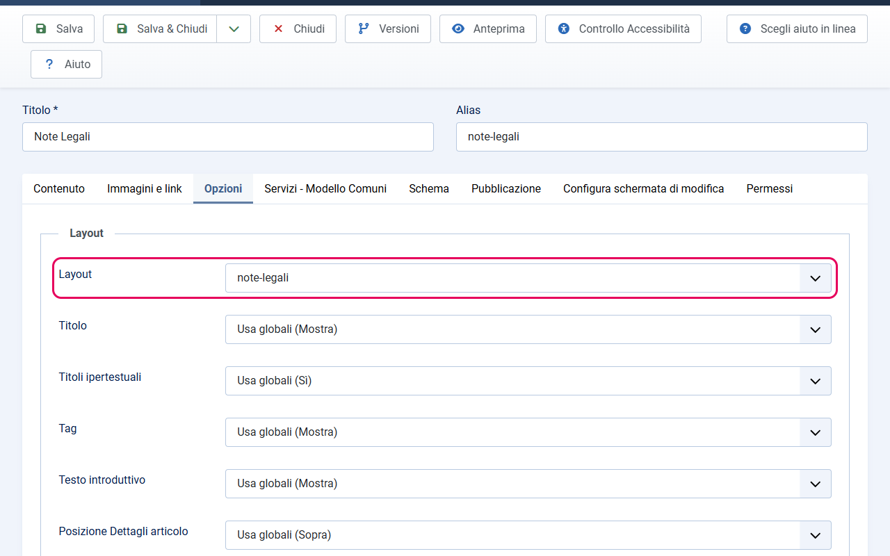
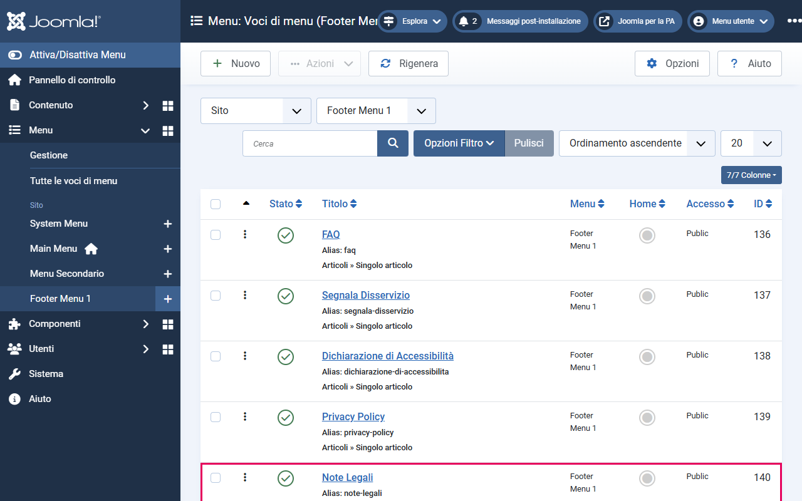
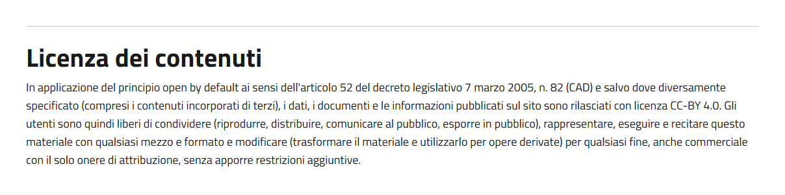

# Pagina Note Legali (C.SI.3.4)

La pagina Note Legali è obbligatoria per la conformità al Modello Comuni (criterio C.SI.3.4). Il template fornisce un layout dedicato che aggiunge automaticamente il testo della licenza Creative Commons BY 4.0 in italiano.

---

## Cosa fa questo layout

Quando assegni il layout `note-legali` a un articolo, il template:

1. Mostra il titolo dell'articolo
2. Mostra il contenuto che hai scritto nell'articolo (introtext e testo completo) — puoi usarlo per note legali specifiche del tuo ente
3. Aggiunge automaticamente in fondo una sezione "Licenza dei contenuti" con il testo completo obbligatorio della licenza CC-BY 4.0 in italiano

Il testo della sezione "Licenza dei contenuti" è **fisso nel template** e non può essere modificato dall'editor. Questo garantisce che il testo ufficiale richiesto dal Modello Comuni non venga alterato accidentalmente.

La sezione aggiunta ha l'attributo `data-element="legal-notes"`, verificato automaticamente dall'App Valutazione Modelli.

---

## Come creare la pagina Note Legali

### Passo 1 — Crea l'articolo

1. Vai su **Contenuto → Articoli → Nuovo**
2. Nel campo **Titolo**, inserisci `Note Legali`
3. Nel campo **Alias**, puoi lasciare quello generato automaticamente (`note-legali`) o personalizzarlo
4. Nel campo **Categoria**, scegli una categoria appropriata (es. "Pagine istituzionali" — una categoria generica per le pagine di servizio del sito)
5. Nell'editor, puoi aggiungere contenuto aggiuntivo specifico del tuo ente: note sul copyright, limitazioni d'uso, riferimenti normativi specifici, ecc. Questo contenuto apparirà **prima** della sezione licenza CC-BY 4.0.
6. Se non hai contenuto aggiuntivo da inserire, puoi lasciare l'editor vuoto — apparirà solo la sezione "Licenza dei contenuti"
7. Non ricopiare nell'articolo il testo della licenza: lo aggiunge il layout, e comparirebbe due volte

### Passo 2 — Assegna il layout `note-legali`

1. Nell'editor dell'articolo, clicca sulla scheda **Opzioni**
2. Trova il campo **Layout**
3. Nel menu a tendina, seleziona `note-legali`

### Passo 3 — Pubblica l'articolo

1. Imposta lo **Stato** su *Pubblicato*
2. Clicca **Salva e chiudi**

### Passo 4 — Crea la voce di menu

Per rendere la pagina raggiungibile, crea una voce di menu che punta all'articolo:

1. Vai su **Menu → [il tuo menu del footer] → Nuovo**
2. In **Tipo di voce di menu**, seleziona **Articoli → Articolo singolo**
3. Nel campo **Articolo**, seleziona l'articolo "Note Legali" appena creato
4. Nel campo **Titolo**, inserisci `Note Legali`
5. Salva

Questa voce di menu va inserita nel footer del sito. Se non hai ancora un menu per il footer, creane uno e assegnalo alla posizione `footer1` o `footer2` (vedi [footer.md](footer.md) e [menu.md](menu.md)).

---

## Come appare la pagina sul frontend

Dopo la configurazione, la pagina Note Legali mostrerà:

1. **Titolo**: "Note Legali" (il titolo dell'articolo)
2. **Corpo**: il contenuto che hai inserito nell'editor (se presente)
3. **Sezione aggiunta automaticamente** con intestazione "Licenza dei contenuti" e il testo CC-BY 4.0

---

## Mapping per la valutazione automatica

Il `data-element="legal-notes"` viene verificato dall'App Valutazione Modelli. Sulla sezione della licenza il layout lo emette automaticamente, senza configurazione. Per averlo anche sul link del footer serve invece associare la voce di menu nella scheda "Valutazione - COMUNI" del template (vedi la nota qui sotto).

---

## Note

- Crea **una sola** pagina Note Legali per sito.
- Il layout non richiede custom fields.
- Se vuoi linkare la pagina Note Legali nel footer, ricordati di farlo anche nella scheda **Valutazione - COMUNI** del template nel campo **Voce «Note legali»** (parametro `de_legal_notes`; vedi [valutazione-modelli.md](valutazione-modelli.md)).
