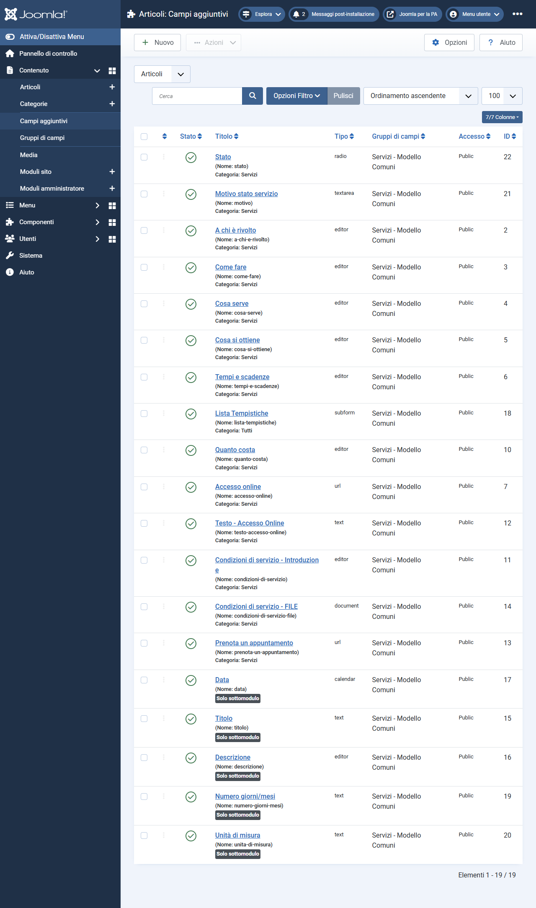
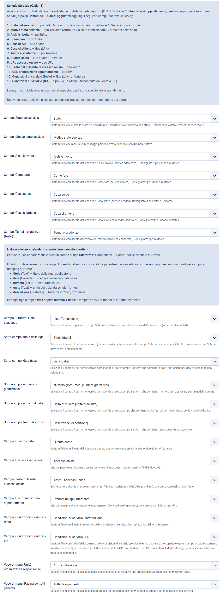
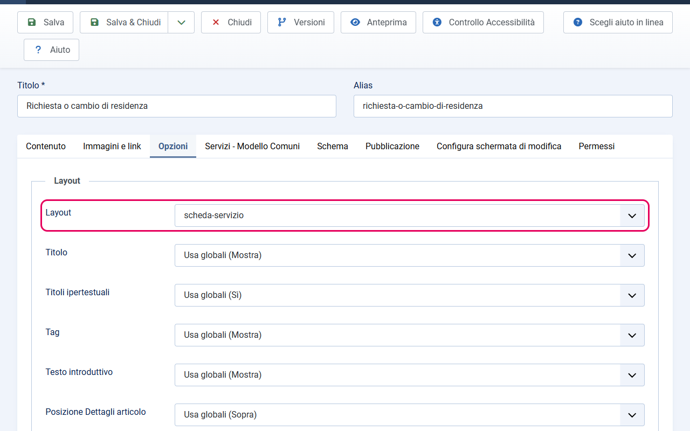
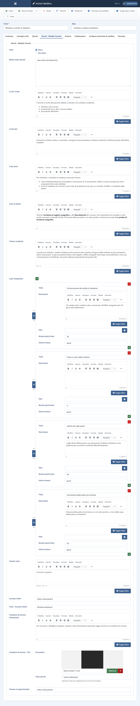
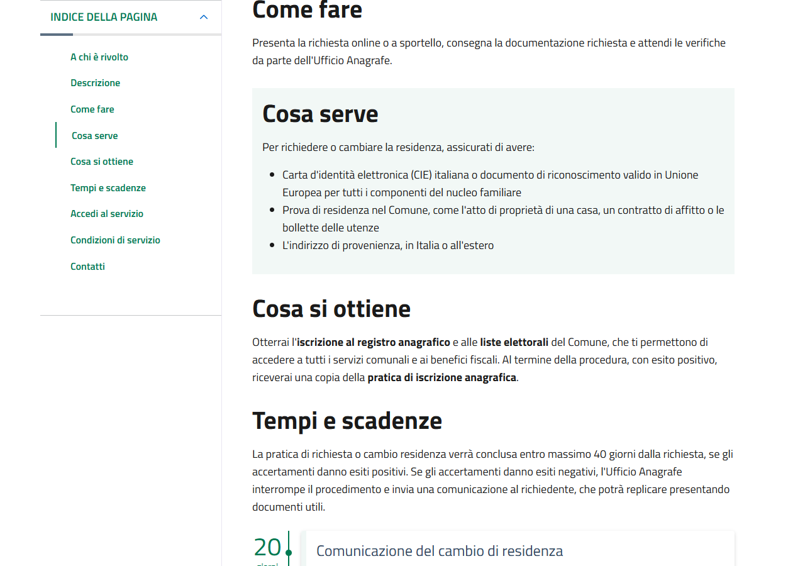

# Scheda Servizio (C.SI.1.3)

> **Modello Comuni** — Questa guida è specifica per i siti web dei Comuni italiani.

La Scheda Servizio è il layout per gli articoli che descrivono in dettaglio un servizio del comune. È richiesta dal criterio C.SI.1.3 del Modello Comuni e verificata automaticamente dall'App Valutazione Modelli.

---

## Cosa genera questo layout

Quando assegni il layout `scheda-servizio` a un articolo, il template genera automaticamente:

- Una **hero** con titolo, badge di stato e testo introduttivo del servizio
- Un **breadcrumb** con il percorso di categoria, che include la voce "Servizi" e la sottocategoria del servizio
- Un **indice di pagina laterale** (scrollspy) con i link alle 8 sezioni principali (più "Descrizione" se l'articolo ha un corpo)
- Fino a **10 sezioni** in ordine fisso, ognuna con il `data-element` corretto per la validazione
- Un blocco **JSON-LD** schema.org (`GovernmentService`) per i motori di ricerca
- Il **widget feedback chiarezza** in fondo (se abilitato nelle impostazioni del template)

---

## Setup: 3 passi necessari

Per usare la Scheda Servizio, devi completare questi 3 passi — **nell'ordine indicato**:

1. Creare i custom field in Joomla (vedi [custom-field-articoli.md](custom-field-articoli.md))
2. Mappare i campi nelle impostazioni del template
3. Creare l'articolo con il layout `scheda-servizio` e compilare i campi

---

## Passo 1 — Crea i custom field

Se non l'hai ancora fatto, vai su [custom-field-articoli.md](custom-field-articoli.md) e segui le istruzioni per creare tutti i campi personalizzati del gruppo "Servizi - Modello Comuni".

Ricorda anche di creare il **Gruppo di Campi** "Servizi - Modello Comuni" prima di creare i singoli campi.

Una volta creati, i campi saranno visibili nella lista **Contenuto → Campi aggiuntivi**.



---

## Passo 2 — Mappa i campi nel template

Dopo aver creato i campi, devi collegare ciascun campo alla sezione corrispondente della Scheda Servizio nelle impostazioni del template.

1. Vai su **Sistema → Stili template sito** e clicca sul nome del template
2. Clicca sulla scheda **Valutazione - COMUNI**
3. Scorri fino alla sezione **Scheda Servizio**
4. Per ogni riga, seleziona il campo corrispondente dal menu a tendina:

| Riga nel template | Campo da selezionare |
|-------------------|---------------------|
| Campo: Stato del servizio | Stato |
| Campo: Motivo stato servizio | Motivo stato servizio |
| Campo: A chi è rivolto | A chi è rivolto |
| Campo: Come fare | Come fare |
| Campo: Cosa serve | Cosa serve |
| Campo: Cosa si ottiene | Cosa si ottiene |
| Campo: Tempi e scadenze (testo) | Tempi e scadenze |
| Campo Subform: Lista scadenze | Lista Tempistiche |
| Sotto-campo: titolo della riga | Titolo |
| Sotto-campo: data fissa | Data |
| Sotto-campo: numero di giorni/mesi | Numero giorni/mesi |
| Sotto-campo: unità di durata | Unità di misura |
| Sotto-campo: testo descrittivo | Descrizione |
| Campo: Quanto costa | Quanto costa |
| Campo: URL accesso online | Accesso online |
| Campo: Testo pulsante accesso online | Testo - Accesso Online |
| Campo: URL prenotazione appuntamento | Prenota un appuntamento |
| Campo: Condizioni di servizio - testo | Condizioni di servizio - Introduzione |
| Campo: Condizioni di servizio - file | Condizioni di servizio - FILE |

5. In fondo alla stessa scheda trovi le due voci di menu usate nella sezione Contatti:

| Riga nel template | Cosa selezionare |
|-------------------|-----------------|
| Voce di menu: Unità organizzativa responsabile | Voce di menu che porta all'ufficio o all'area responsabile del servizio |
| Voce di menu: Pagina contatti generali | Voce di menu che porta alla pagina Contatti generali dell'ente |

Questi menu item devono esistere già in Joomla. Se non li hai ancora creati, crea prima le pagine e le voci di menu corrispondenti, poi torna qui a completare il mapping.

6. Clicca **Salva**



---

## Passo 3 — Crea l'articolo e assegna il layout

### 3a. Crea un nuovo articolo

1. Vai su **Contenuto → Articoli → Nuovo**
2. Nel campo **Titolo**, inserisci il nome del servizio (es. `Iscrizione all'asilo nido`). Questo sarà il titolo mostrato nella hero con `data-element="service-title"`.
3. Nel campo **Alias**, lascia quello generato automaticamente o personalizzalo
4. Nel campo **Categoria**, seleziona la sottocategoria di Servizi corretta (es. `Educazione e formazione`). Il nome della categoria comparirà nel blocco JSON-LD come `serviceType`.

### 3b. Compila il testo introduttivo

Nell'editor, scrivi il testo introduttivo del servizio nel campo **Testo introduttivo** (la parte prima del tag "Leggi di più", se usi la suddivisione). Questo testo viene mostrato come `data-element="service-description"` nella hero e come `description` nel blocco JSON-LD.

Se hai anche del testo nel corpo dell'articolo (la parte dopo "Leggi di più"), questo viene mostrato come sezione **Descrizione** aggiuntiva nella Scheda Servizio, prima delle sezioni A chi è rivolto, Come fare, ecc.

> **Importante:** il **testo introduttivo** è la descrizione principale del servizio — compilalo sempre con un testo chiaro e sintetico (almeno 3 caratteri, preferibilmente alcune frasi). Il **corpo** è opzionale e serve per dettagli aggiuntivi.

### 3c. Assegna il layout alternativo

1. Clicca sulla scheda **Opzioni** (tra le schede sopra l'editor)
2. Nel campo **Layout**, seleziona `scheda-servizio`

In alternativa puoi impostare il layout una volta sola per tutti i servizi: nella voce di menu della categoria Servizi, scheda **Opzioni**, campo **Scegli un layout**. Gli articoli che lasciano il campo su "Usa globali" lo ereditano.



### 3d. Compila i custom field

1. Clicca sulla scheda **Servizi - Modello Comuni** (o il nome del gruppo di campi che hai creato)
2. Compila tutti i campi rilevanti per questo servizio. Attenzione: solo **Quanto costa** scompare quando il campo è vuoto. Le altre sezioni mostrano comunque il titolo, quindi un campo lasciato vuoto produce una sezione senza contenuto (e il validatore la segnala).

Per il campo **Stato** scegli *Servizio attivo* o *Servizio non attivo*. Con *non attivo* il badge diventa rosso e, se compilato, viene mostrato il testo del campo **Motivo stato servizio**.

Per ogni campo di tipo Editor, usa l'editor visuale per formattare il testo (elenchi puntati, grassetti, link, ecc.).

Per il campo **Lista Tempistiche** (Subform):
- Clicca **Aggiungi riga** per ogni scadenza
- Per ogni riga, compila Titolo e poi: o la **Data** (per una data specifica) o **Numero giorni/mesi + Unità di misura** (es. `30` giorni)
- La **Descrizione** è opzionale per ogni riga

Per il campo **Condizioni di servizio - FILE**: su Joomla 6.1 o superiore è un campo di tipo **Documento**, quindi clicca sul campo, scegli o carica il PDF nella cartella Documenti e, se vuoi, compila il **Testo del link**. Su Joomla 5.x / 6.0 è un campo di tipo **URL**: carica prima il PDF da **Contenuto → Media** (cartella Documenti), copia il suo indirizzo e incollalo nel campo. I dettagli sono in [custom-field-articoli.md](custom-field-articoli.md).



### 3e. Imposta la visibilità nei Servizi in evidenza

Se questo servizio deve apparire nella sidebar "Servizi in evidenza" nella pagina della categoria:
- Nella scheda **Contenuto**, colonna destra → **In evidenza**: **Sì**

### 3f. Aggiungi i tag (argomenti)

I tag dell'articolo vengono mostrati nell'intestazione della Scheda Servizio, a destra, come "Argomenti", con `data-element="service-topic"`. È richiesto dall'App Valutazione Modelli che almeno un tag/argomento sia presente.

- Nel campo **Tag** (scheda **Contenuto**, colonna destra), digita i tag del servizio (es. `anagrafe`, `certificati`, `documenti`) e premi Invio per ognuno

### 3g. Pubblica e salva

1. Imposta lo **Stato** su *Pubblicato*
2. Clicca **Salva e chiudi**

---

## Struttura delle sezioni della Scheda Servizio

Le sezioni della scheda appaiono sempre in questo ordine fisso, indipendentemente dall'ordine dei campi. Solo due sezioni sono condizionali: **Descrizione** (presente se l'articolo ha un corpo dopo "Leggi di più") e **Quanto costa** (presente se il campo è compilato). Tutte le altre vengono sempre mostrate con il loro titolo, anche se il campo è vuoto.

| # | Titolo sezione | Campo corrispondente | data-element | Sempre presente |
|---|---------------|---------------------|-------------|-----------------|
| 1 | A chi è rivolto | A chi è rivolto | `service-addressed` | Sì |
| 2 | Descrizione | Corpo dell'articolo | `service-extended-description` | Solo se c'è il corpo |
| 3 | Come fare | Come fare | `service-how-to` | Sì |
| 4 | Cosa serve | Cosa serve | `service-needed` | Sì |
| 5 | Cosa si ottiene | Cosa si ottiene | `service-achieved` | Sì |
| 6 | Tempi e scadenze | Tempi e scadenze + Lista Tempistiche | `service-calendar-text` / `service-calendar-list` | Sì |
| 7 | Quanto costa | Quanto costa | `service-cost` | Solo se compilato |
| 8 | Accedi al servizio | Accesso online + Prenota un appuntamento | `service-generic-access` / `service-online-access` / `service-booking-access` | Sì |
| 9 | Condizioni di servizio | Condizioni (testo) + Condizioni (file) | `service-file` | Sì |
| 10 | Contatti | Voce di menu ufficio + Voce di menu contatti | `service-area` / `contacts` | Sì |

Se l'articolo ha un livello di accesso riservato e in Joomla è attiva l'opzione **Mostra link non autorizzati**, chi non ha accesso vede solo titolo e testo introduttivo, con un avviso e il link per accedere.

---

## Indice di pagina (scrollspy)

Il layout genera automaticamente un indice laterale (`data-element="page-index"`) con i link alle sezioni principali. L'indice evidenzia la sezione corrente durante lo scroll della pagina.

Le etichette dell'indice sono fisse e definite dal template:

```
A chi è rivolto
Come fare
Cosa serve
Cosa si ottiene
Tempi e scadenze
Accedi al servizio
Condizioni di servizio
Contatti
```

Se l'articolo ha un corpo, tra "A chi è rivolto" e "Come fare" compare anche la voce **Descrizione**.

**Nota:** la sezione "Quanto costa" non appare nell'indice (è considerata sezione secondaria dal Modello Comuni), ma viene comunque mostrata nel corpo della pagina.



---

## Blocco JSON-LD (GovernmentService)

Il layout genera automaticamente un blocco `<script type="application/ld+json" data-element="metatag">` con il seguente schema:

```json
{
  "@context": "https://schema.org",
  "@type": "GovernmentService",
  "name": "[titolo dell'articolo]",
  "description": "[testo introduttivo dell'articolo]",
  "serviceType": "[nome della categoria dell'articolo]",
  "areaServed": "[valore del campo nomesito del template]",
  "url": "[URL corrente della pagina]"
}
```

Non è richiesta nessuna configurazione aggiuntiva per questo blocco.

---

## Come verificare la conformità

L'App Valutazione Modelli (Dipartimento per la Trasformazione Digitale) verifica automaticamente la presenza e il contenuto dei `data-element`. Per superare la verifica:

- Ogni sezione deve avere contenuto di **almeno 3 caratteri**
- Il breadcrumb deve contenere la voce "Servizi" e il nome della sottocategoria
- L'indice di pagina deve avere le 8 voci con le etichette esatte in italiano
- Almeno un tag/argomento deve essere presente (`data-element="service-topic"`)
- Il blocco JSON-LD deve essere presente

Nel report del sito dimostrativo il criterio C.SI.1.3 risulta superato: i due criteri non superati (C.SI.3.2 e C.SI.5.2) non riguardano la Scheda Servizio.


