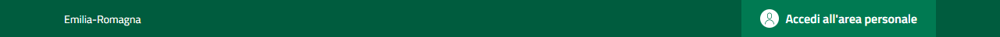
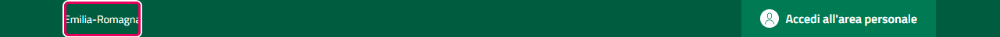
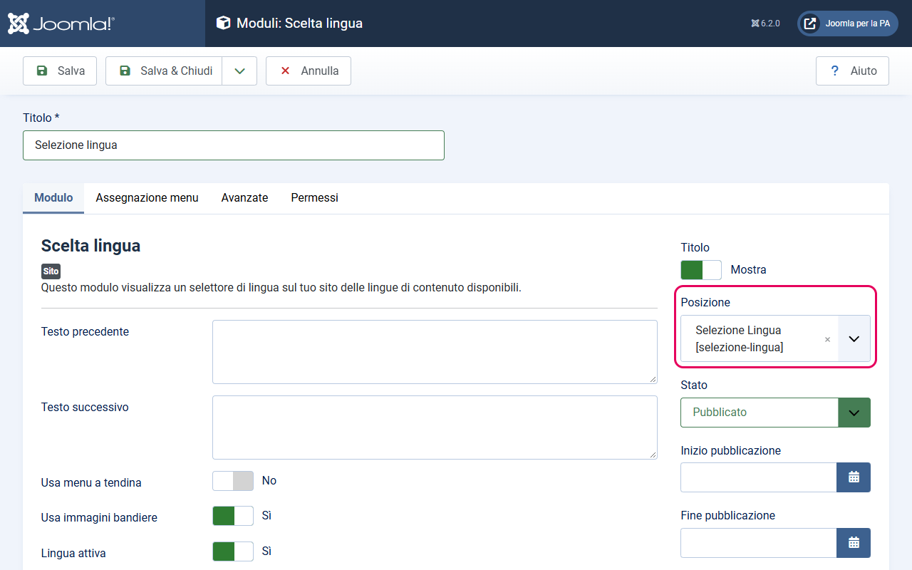

# Topbar (banda slim superiore)

La topbar è la striscia sottile nella parte più alta della pagina, sopra all'header principale. Si vede su tutti i dispositivi e non è possibile nasconderla.

---

## Cosa contiene

La topbar è divisa in due aree:

- **Sinistra**: il nome della regione (o ente sovraordinato) con eventuale link al sito della regione
- **Destra**: la posizione modulo `selezione-lingua` — uno slot vuoto dove puoi inserire un modulo di cambio lingua — e, se abilitato, il pulsante **Accedi all'area personale** (vedi [header.md](header.md))

---

## Come configurare il nome della regione

1. Vai su **Sistema → Stili template sito** e clicca sul nome del template
2. Nella scheda **Dettagli**, trova i campi **Nome dell'ente sovraordinato** e **Url sito ente sovraordinato**
3. Nel campo **Nome dell'ente sovraordinato**, inserisci il nome dell'ente sovraordinato (es. `Regione Lombardia` oppure `Città Metropolitana di Milano`)
4. Nel campo **Url sito ente sovraordinato**, inserisci l'URL completo del sito (es. `https://www.regione.lombardia.it`) — questo trasformerà il testo in un link cliccabile
5. Salva

**Cosa succede se Url sito ente sovraordinato è vuoto:** il nome della regione appare come testo semplice, senza link.

**Cosa succede se anche Nome dell'ente sovraordinato è vuoto:** la sinistra della topbar rimane vuota. La topbar rimane comunque visibile, ma non mostra nulla a sinistra.

---

## Come configurare il cambio lingua (selezione-lingua)

La posizione `selezione-lingua` è pensata per siti multilingua. Se il tuo sito è solo in italiano, puoi ignorare questa sezione.

Per aggiungere un modulo di cambio lingua:

1. Vai su **Contenuto → Moduli sito → Nuovo**
2. Seleziona il tipo **Scelta lingua** (`mod_languages`)
3. Nella scheda **Modulo** → campo **Posizione** (colonna destra): inserisci o seleziona `selezione-lingua`
4. Configura il modulo secondo le tue esigenze (immagini bandiere, testo, ecc.)
5. Imposta lo stato su **Pubblicato** e salva

---

## Note tecniche

- La topbar ha sempre lo stesso colore del colore primario selezionato, leggermente scurito (circa 25%). Non è possibile cambiare questo comportamento senza modificare il CSS del template.
- La topbar è inclusa automaticamente in tutte le pagine del sito: non ci sono impostazioni per nasconderla.
